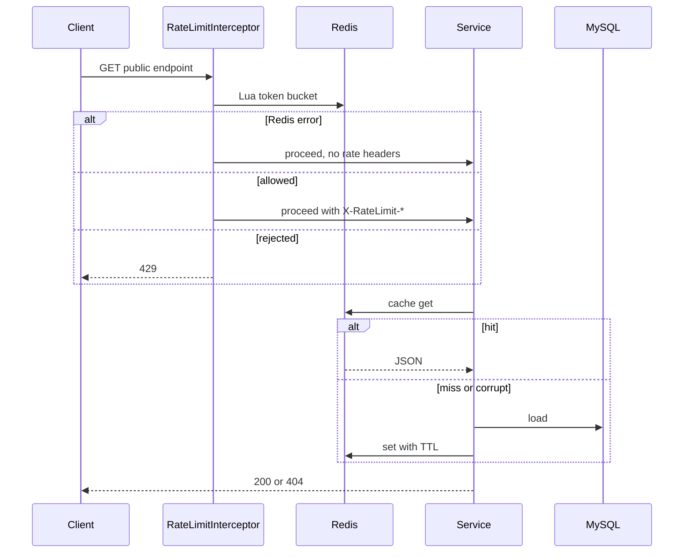

# Phase 1 architecture (as built)

Learner-facing summary of the running system. Detailed design history lives under [`files/`](../files/) ([`PROJECT.md`](../files/PROJECT.md), [`FLOW.md`](../files/FLOW.md), [`API.md`](../files/API.md)).

## Runtime

| Layer | Role |
|-------|------|
| **MySQL 8** | Source of truth (products, inventory, Flyway schema) |
| **Redis 7.2** | Optional cache, rate-limit state, dev sandbox only |
| **Spring Boot 3.5** | HTTP API, JPA, Lettuce, actuator |

Redis is **non-critical**: public reads and admin writes succeed when Redis is unavailable ([R-10]). Dev sandbox endpoints are **fail-closed** (`503`).

Environment prefix for keys: `redis-lab:{app.environment}:` (e.g. `dev`, `test`).

## Packages

| Package | Responsibility |
|---------|----------------|
| `product/` | Product entities, public/admin APIs, catalog writes |
| `inventory/` | Stock reads/writes, optimistic locking |
| `cache/` | Cache-aside services, `RedisKeyBuilder`, JSON codec, fail-safe wrapper |
| `ratelimit/` | Lua token bucket, interceptor, headers |
| `redis/` | Dev-only sandbox and serialization demo (`@Profile("dev")`) |
| `config/` | Properties, Web MVC, Redis/health/OpenAPI |
| `common/` | Errors, pagination, admin key interceptor |

## Redis key catalog

| Purpose | Key pattern | Type | TTL |
|---------|-------------|------|-----|
| Product detail | `product:{id}` | String (JSON) | 15 min |
| Product list page | `products:page:{page}:size:{size}` | String (JSON) | 15 min |
| Inventory | `inventory:{productId}` | String (JSON) | 30 s |
| Rate limit | `rate-limit:{clientIp}` | Hash (`tokens`, `last_refill_time`) | dynamic |
| Dev sandbox | `sandbox:{logicalKey}` | String | caller TTL |

List eviction uses **`SCAN` + `UNLINK`** on `products:page:*` (never `KEYS` in Java).

## Public read path

Rate-limited routes: `GET /api/products`, `GET /api/products/{id}`, `GET /api/inventory/{productId}`.

## Invalidation (after MySQL commit)

| Change | Product key | List pages | Inventory key |
|--------|-------------|------------|---------------|
| Create product | – | evict all | – |
| Update product (changed) | evict | evict all | – |
| Activate / deactivate (changed) | evict | evict all | evict |
| Inventory set / inc / dec | – | – | evict |
| No-op update / repeat activate | keep | keep | keep |

Implemented in [`ProductServiceImpl`](../src/main/java/com/redislab/product/service/ProductServiceImpl.java) and [`InventoryServiceImpl`](../src/main/java/com/redislab/inventory/service/InventoryServiceImpl.java). Automated checks: `CacheInvalidationIT`.

## Failure modes (Phase 1)

| Operation | Redis down / OOM on write | User impact |
|-----------|---------------------------|-------------|
| Public cache read | Fail-open → MySQL | 200/404, slightly slower |
| Cache write on miss | Logged, skipped | Still 200 from MySQL |
| Post-commit evict | Logged, skipped | Stale until TTL |
| Rate limiter | Fail-open | No limit headers; requests allowed |
| Actuator health | `redis` = `DEGRADED` | Overall **UP** (HTTP 200) |
| Dev sandbox | `503 REDIS_UNAVAILABLE` | Intentional |

## API surface

**13 business endpoints** per [`API.md`](../files/API.md) (public reads 1–3, admin catalog 4–9, admin inventory 10–13). **Dev** adds `/api/dev/redis/**` only with `spring.profiles.active=dev` and `app.dev-endpoints.enabled=true`. Controllers are not registered outside `dev` — no sandbox mapping on a non-dev profile.

## Tests

- **Unit** — profile `test`, mock Redis (`*Test.java`).
- **Integration** — profile `it`, Testcontainers MySQL + Redis (`*IT.java`). See [`experiments.md`](experiments.md) for the §21.2 map.

## Further reading

- Request sequences: [`files/FLOW.md`](../files/FLOW.md)
- Implementation detail: [`files/IMPLEMENTATION.md`](../files/IMPLEMENTATION.md)
- Redis concepts in this repo: [`redis-fundamentals.md`](redis-fundamentals.md)
