# FLOW.md — API and System Design Flows

> Part of the documentation set: [`PROJECT.md`](PROJECT.md) · [`IMPLEMENTATION.md`](IMPLEMENTATION.md) · **`FLOW.md`** · [`ROADMAP.md`](ROADMAP.md) · [`API.md`](API.md)
> This file explains **how requests travel through the system**. Field-level contracts live in [API.md](API.md); class-level detail in [IMPLEMENTATION.md](IMPLEMENTATION.md). Decision tags: **[Confirmed]**, **[Resolved R-xx]**, **[Open O-xx]** ([register](PROJECT.md#17-decision-register)).

## Contents

1. Overall architecture · 2. Public vs admin pipeline · 3. Product creation · 4. Product update · 4b. Activate / deactivate · 5–7. Product detail (hit, miss, Redis down) · 8. Product listing · 9. Inventory read · 10. Inventory writes · 11. Admin API-key validation · 12. Cache invalidation · 13–16. Token bucket, Lua, rejection, Redis failure · 17. Global exception handling · 18. Redis and MySQL interaction overview · 19. Phase 2 flows · 20. Phase 3 flows

---

## 1. Overall application architecture

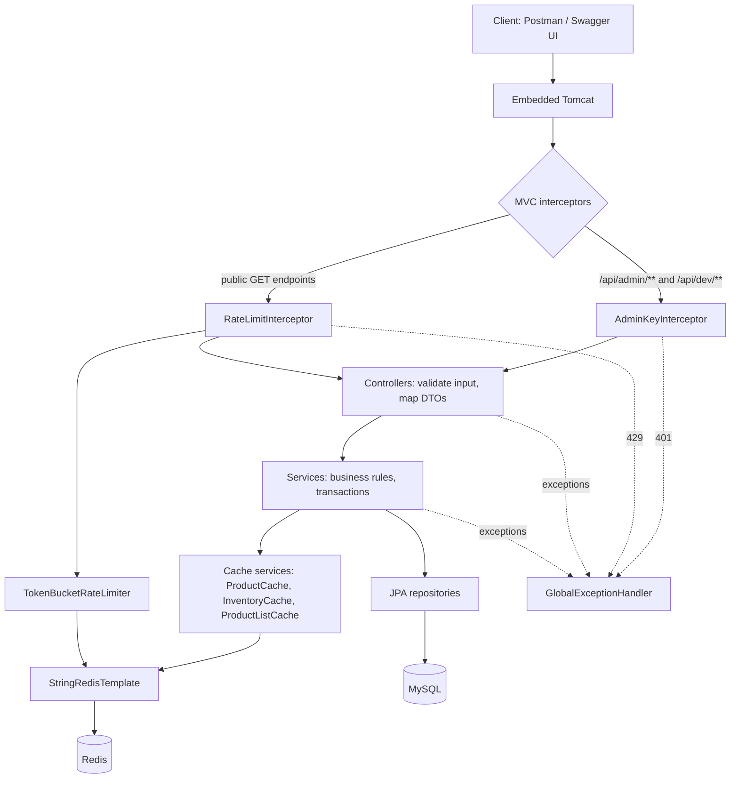

Fixed rules shown here: business services never call Redis commands directly; the dotted lines are exception paths ending in one JSON error format ([§17](#17-global-exception-handling)).

## 2. Public vs admin request flow comparison

| Aspect | Public read (`GET /api/products/**`, `/api/inventory/**`) | Admin (`/api/admin/**`) |
|---|---|---|
| Auth | none | `X-Admin-Key` → `401` |
| Rate limit | yes, token bucket per IP | no |
| First check | rate limit | admin key |
| Redis role | cache-aside read | **only invalidation** (admin reads bypass Redis) |
| MySQL | on miss / fallback | always |
| Inactive products | `404` | visible and manageable |
| Redis down | fall back to MySQL; limiter fails open | writes succeed; invalidation skipped and logged |

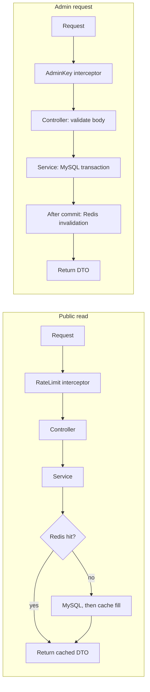

---

## 3. Product creation

`POST /api/admin/products` — **[Confirmed]** flow.

| Item | Detail |
|---|---|
| Starting request | Admin sends name, description, price with `X-Admin-Key` |
| Components | AdminKeyInterceptor → AdminProductController → ProductService (`TransactionTemplate`) → ProductRepository / InventoryRepository → ProductListCacheService |
| Order | key check → bean validation → **begin tx** → insert product → insert inventory(0) → **commit** → invalidate list pages → `201` |
| MySQL | 2 inserts in one transaction |
| Redis | `SCAN` + `UNLINK` of `products:page:*` **after** commit; nothing for product/inventory (not cached yet) |
| Success | `201 Created` + product DTO (`version` 0) |
| Failures | `401` bad key · `400` validation · MySQL failure → rollback, **no** Redis action, `500` · Redis failure after commit → logged, still `201` |

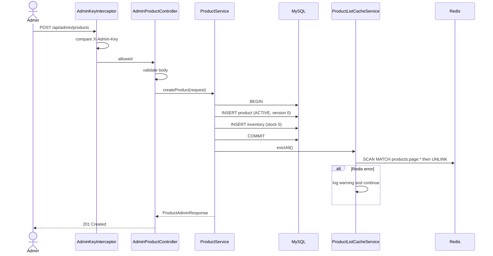

Why invalidate after commit: if the transaction rolled back after we had deleted cache entries, we would have thrown away valid cache data for nothing; worse, a concurrent reader could re-cache the pre-commit state. Implementation note: [IMPLEMENTATION.md §9.2](IMPLEMENTATION.md#92-transaction-and-invalidation-pattern).

## 4. Product update

`PUT /api/admin/products/{id}` — **[Confirmed]** + checks ordered by [R-17].

| Item | Detail |
|---|---|
| Components | AdminKeyInterceptor → controller → ProductService → ProductRepository → ProductCacheService + ProductListCacheService |
| MySQL | read product (and compare), then `UPDATE … WHERE id=? AND version=?` |
| Redis | delete `product:{id}` + all list pages, after commit, only if changed |
| Success | `200` + updated DTO, `version` +1; or `200` unchanged (no-op) |
| Failures | `404` missing · `409 CONCURRENT_MODIFICATION` stale version (either from the explicit compare or Hibernate's optimistic-lock exception) · `400` validation · Redis failure → logged |

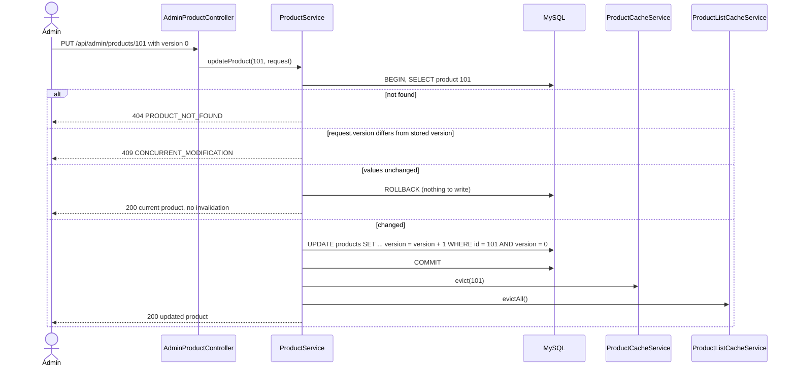

The classic lost-update scenario: two admins both read version 1; the first `PUT` succeeds (→ 2); the second still sends 1 → `409`, forcing a re-read.

## 4b. Product activation and deactivation

`PATCH /api/admin/products/{id}/activate|deactivate`

| Item | Detail |
|---|---|
| Redis | On a **real** status change: delete `product:{id}`, `inventory:{id}`, all list pages (after commit). Repeats do nothing. |
| MySQL | `UPDATE products SET status=?, version=version+1` only when status differs |
| Success | `200` `{id, status, version}` |
| Failures | `404`; Redis failure logged |

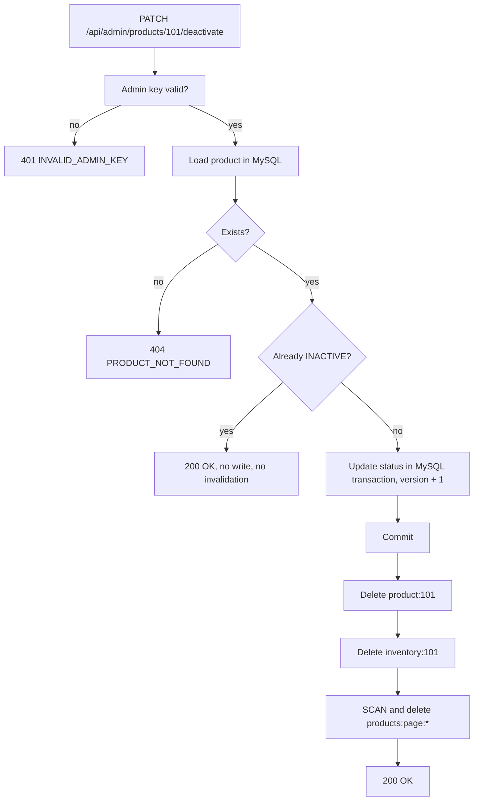

---

## 5. Product detail read — cache hit

`GET /api/products/101`

| Item | Detail |
|---|---|
| Order | rate limit → controller → ProductService → `GET redis-lab:dev:product:101` |
| Redis | 1 × `GET` |
| MySQL | **none** |
| Success | `200` cached DTO (+ rate-limit headers) |

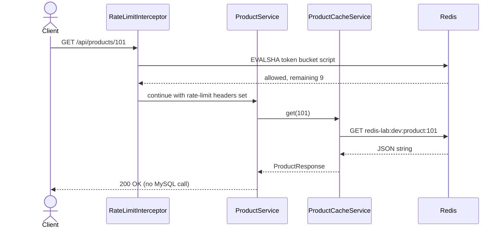

## 6. Product detail read — cache miss

| Item | Detail |
|---|---|
| Redis | `GET` (nil) → `SET … EX 900` |
| MySQL | `SELECT … WHERE id=101 AND status='ACTIVE'` |
| Success | `200` DTO |
| Failures | missing/inactive → `404` **without caching** · cache write fails → log, still `200` |

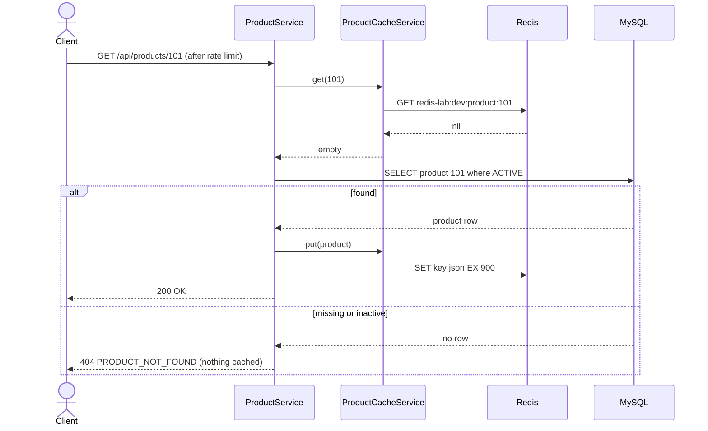

Phase 1 intentionally has **no stampede protection**: if 100 requests miss together, 100 MySQL queries run ([§19.1](#191-stampede-protection-with-a-redis-lock-planned)).

## 7. Product read when Redis is unavailable

| Item | Detail |
|---|---|
| Trigger | Redis stopped, network failure, command timeout (1 s), or OOM on write |
| Behavior | Cache read error = miss → MySQL; cache write skipped; `200` returned |
| Logs | `CACHE_READ_FAILED`, `CACHE_WRITE_SKIPPED` with the exception type |
| Speed | Lettuce rejects commands immediately while disconnected ([R-10]), so no 1 s delay per request during a full outage; a "black-holed" network can still cost up to 1 s per request |
| Recovery | Lettuce reconnects automatically; next request that misses refills the key (lazy rebuild) |

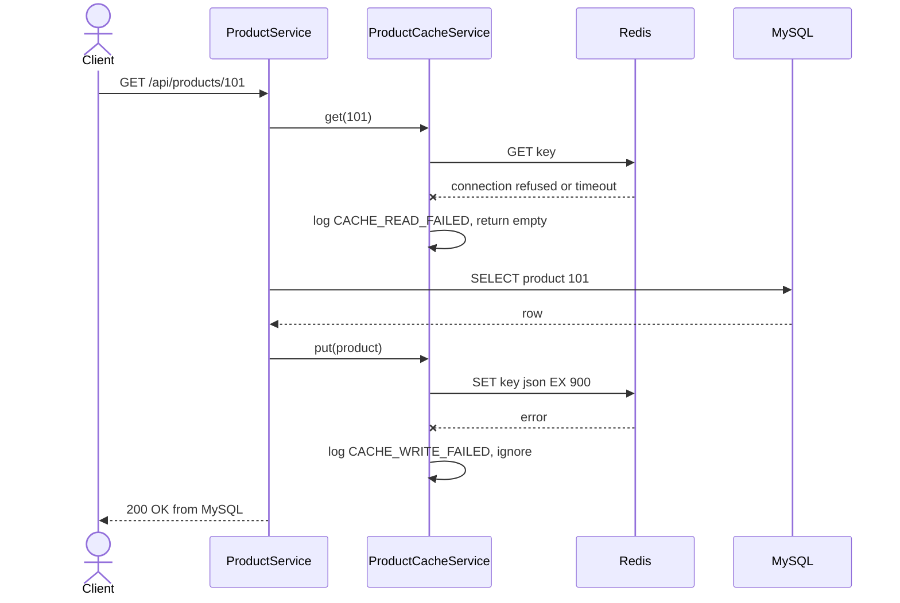

---

## 8. Paginated product listing

`GET /api/products?page=0&size=20` (public) and `GET /api/admin/products` (admin).

| Item | Public | Admin |
|---|---|---|
| Validation | page ≥ 0, 1 ≤ size ≤ 50 → else `400 INVALID_PAGINATION` | same |
| Redis | key `products:page:{p}:size:{s}`, TTL 15 min | none |
| MySQL | `status='ACTIVE' ORDER BY created_at DESC, id DESC` + count | no status filter |
| Cache fill rule | not for empty pages with page > 0 ([R-15]) | – |

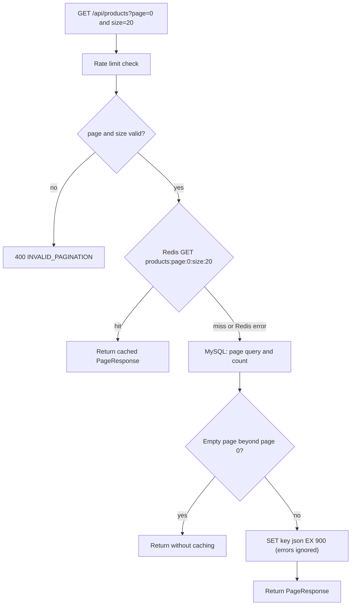

**Why pages are invalidated together:** creating one product shifts every later page ([Confirmed] example: page 1 held products 80–61, after one insert it holds 81–62), so all cached pages become wrong.

## 9. Inventory read

`GET /api/inventory/101` — same pattern as product detail with TTL **30 s** and a status check.

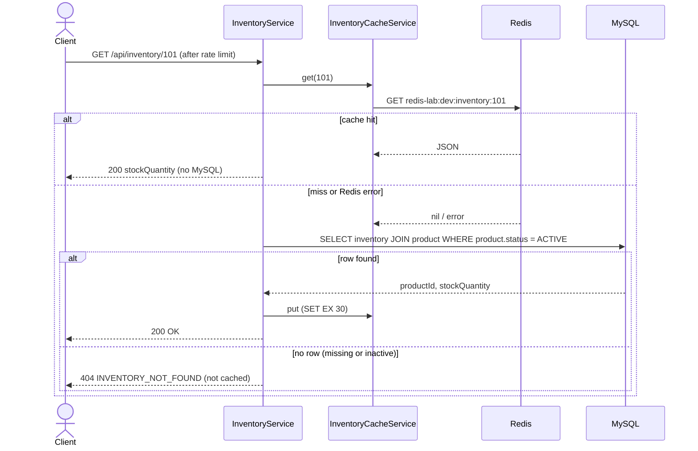

Because only **active** products are ever written to this cache and deactivation deletes the key, a hit is always safe to return without re-checking the product status (subject to the race in [PROJECT.md §11](PROJECT.md#known-cache-consistency-limits-accepted-in-phase-1-resolved-r-24)).

## 10. Inventory writes

Common steps: admin key → validation → MySQL transaction → **commit** → delete `redis-lab:dev:inventory:{id}` → return admin inventory DTO `{productId, stockQuantity, version}`. Redis failure on delete: log, still `200`; stale value lives ≤ 30 s.

### 10.1 Set (`PUT /api/admin/inventory/101`) — optimistic locking

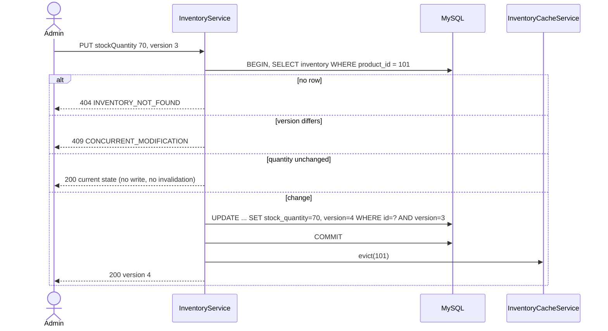

### 10.2 Increment — atomic SQL

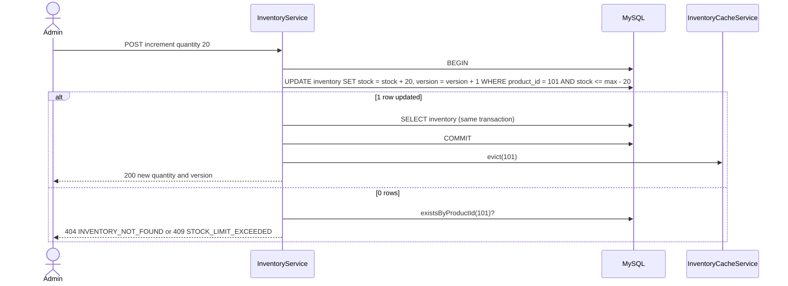

### 10.3 Decrement — conditional atomic SQL

Identical to 10.2 but the SQL is `stock = stock - :q … AND stock >= :q`; zero rows updated + product exists → `409 INSUFFICIENT_STOCK`.

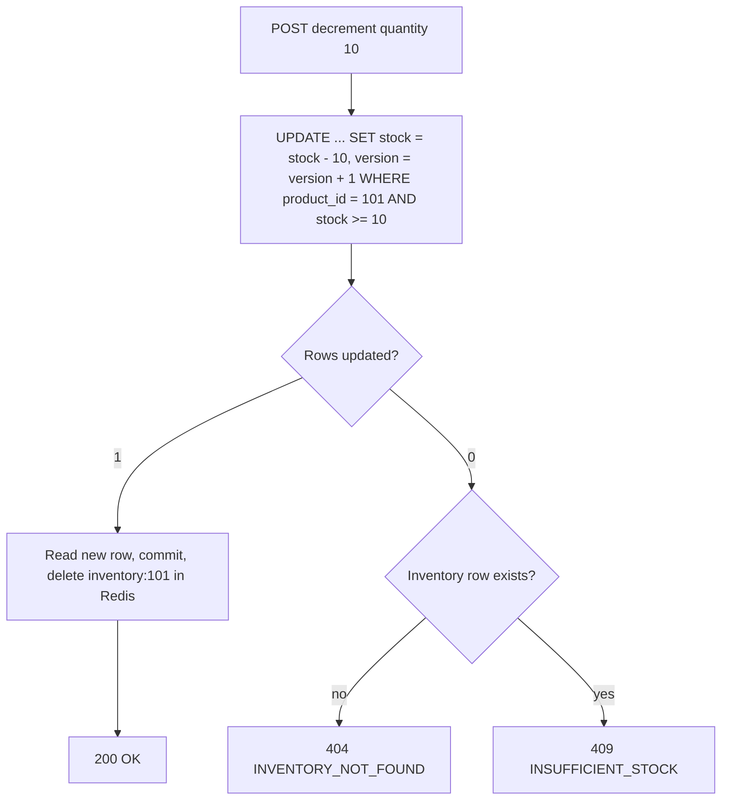

Why this is safe under concurrency: MySQL serializes updates to one row; the `WHERE stock >= :q` test and the subtraction happen in the same statement, so 100 customers racing for the last 5 units get exactly 5 successes (verified by a test in Stage 9).

---

## 11. Admin API-key validation

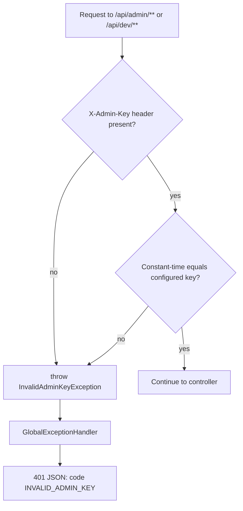

The key is never logged. The check happens before body parsing/validation so unauthenticated callers learn nothing about the API's validation rules.

## 12. Cache invalidation

### 12.1 Invalidation matrix (authoritative)

| Trigger (after MySQL commit) | `product:{id}` | `inventory:{id}` | `products:page:*` | Notes |
|---|---|---|---|---|
| Create product | – | – | ✅ | New product shifts pagination |
| Update product (changed) | ✅ | – | ✅ | Price/name appear in lists |
| Update product (unchanged) | – | – | – | No write happened |
| Activate (INACTIVE→ACTIVE) | ✅ | ✅ | ✅ | |
| Deactivate (ACTIVE→INACTIVE) | ✅ | ✅ | ✅ | |
| Activate/deactivate repeat | – | – | – | Idempotent |
| Set inventory (changed) | – | ✅ | – | |
| Increment inventory | – | ✅ | – | |
| Decrement inventory | – | ✅ | – | |
| Admin reads | – | – | – | Never cached |
| TTL expiry | automatic | automatic | automatic | Safety net |

### 12.2 List-page deletion with SCAN **[Resolved R-14]**

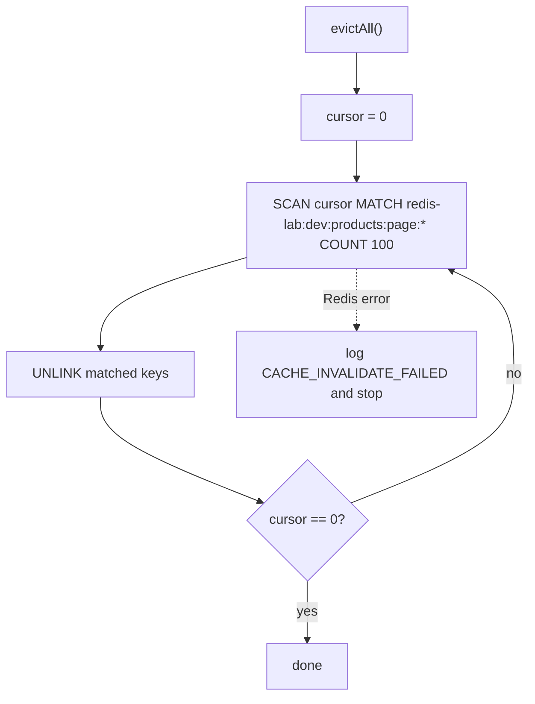

`KEYS` is never used (it blocks Redis while scanning the whole keyspace). `SCAN` may miss keys created while scanning; those expire by TTL — acceptable for the lab and revisited in Phase 5 (page-version experiment, [O-05]).

### 12.3 Ordering and failure behavior

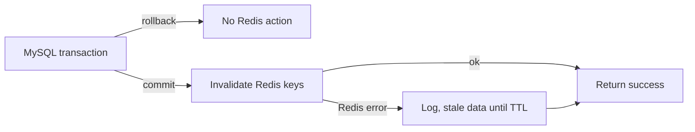

---

## 13. Redis token bucket

Every rate-limited request consumes **1 token** from the bucket of its client IP. Bucket: capacity 10, refill 1/s, one shared bucket for all public reads, Redis Hash `redis-lab:dev:rate-limit:{ip}` with fields `tokens` and `last_refill_time`.

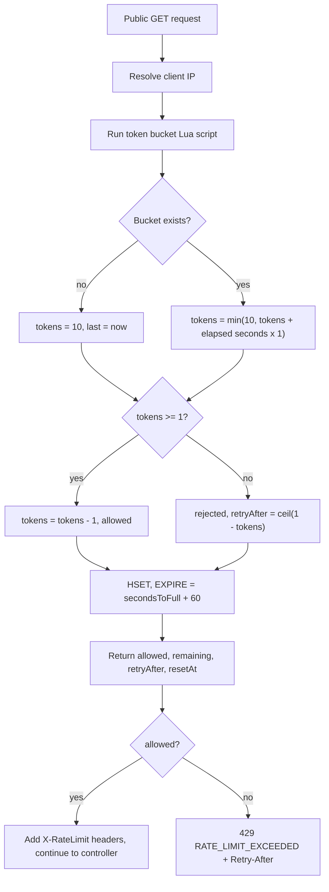

Example timeline (capacity 10, 1/s): t=0 → 10 rapid requests succeed (remaining 9…0); request 11 at t=0.2 s → rejected, `Retry-After: 1`; at t=1.2 s one token has refilled → one more request passes.

## 14. Lua script execution

Why Lua: "read tokens → compute refill → decrement" is several steps. Two app instances doing them separately could both spend the same token. A Lua script runs **atomically** inside Redis (no other command interleaves), and also reads the clock from Redis (`TIME`) so all instances share one clock **[R-11]**.

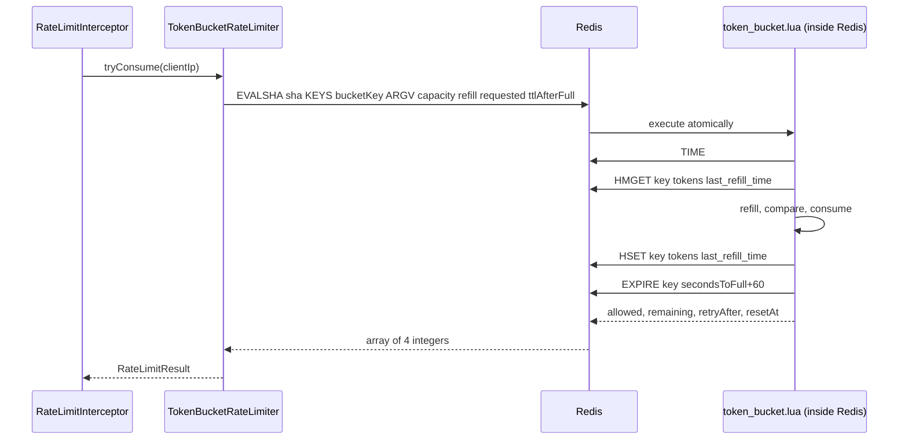

Spring sends the script's SHA via `EVALSHA` and falls back to `EVAL` automatically if the script is not cached yet. Script text: [IMPLEMENTATION.md §20.3](IMPLEMENTATION.md#203-lua-script).

## 15. Rate-limit rejection

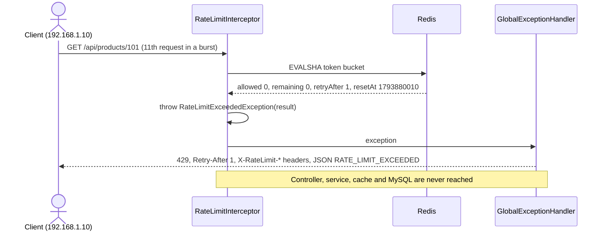

The rejection is logged as `RATE_LIMIT_REJECTED ip=… ` (rate-limit logs are part of Phase 1 observability).

## 16. Redis failure during rate limiting

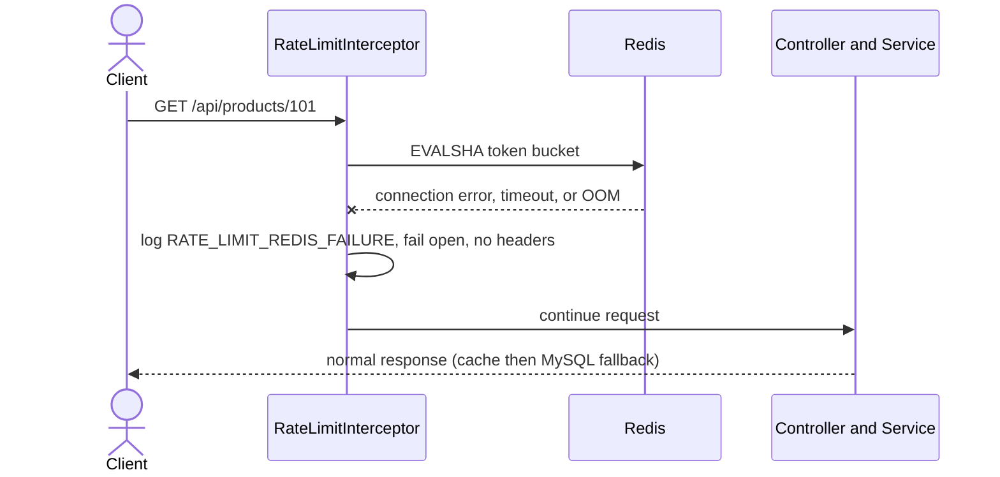

Trade-off **[Confirmed]**: limits can be bypassed while Redis is down or full. With `noeviction` and a full Redis, the script's `HSET` is refused (OOM), so the limiter fails open as well; this is a deliberate Phase 4 experiment. Fail-closed (`503`) is a later experiment ([O-11]).

---

## 17. Global exception handling

All failures converge on one JSON structure `{timestamp, status, code, message, path[, fieldErrors]}`.

```mermaid
flowchart TD
    E["Exception thrown in interceptor, controller or service"] --> G["GlobalExceptionHandler (@RestControllerAdvice)"]
    G --> T{"Exception type"}
    T -->|"MethodArgumentNotValidException"| V["400 VALIDATION_FAILED + fieldErrors"]
    T -->|"HttpMessageNotReadableException"| M["400 MALFORMED_REQUEST"]
    T -->|"type mismatch or bad pagination"| P["400 INVALID_PARAMETER / INVALID_PAGINATION"]
    T -->|"InvalidAdminKeyException"| A["401 INVALID_ADMIN_KEY"]
    T -->|"ProductNotFoundException"| N1["404 PRODUCT_NOT_FOUND"]
    T -->|"InventoryNotFoundException"| N2["404 INVENTORY_NOT_FOUND"]
    T -->|"ConcurrentModification / OptimisticLocking"| K1["409 CONCURRENT_MODIFICATION"]
    T -->|"InsufficientStockException"| K2["409 INSUFFICIENT_STOCK"]
    T -->|"StockLimitExceededException"| K3["409 STOCK_LIMIT_EXCEEDED"]
    T -->|"RateLimitExceededException"| R["429 RATE_LIMIT_EXCEEDED + headers"]
    T -->|"anything else"| I["Log full stack trace, return generic 500 INTERNAL_SERVER_ERROR"]
```

Redis exceptions are **not** in this list for business endpoints — they are caught in the cache layer ([IMPLEMENTATION.md §19](IMPLEMENTATION.md#19-redis-failure-fallback)). Only the dev sandbox maps them to `503 REDIS_UNAVAILABLE`. Interceptors (not servlet filters) are used so these exceptions reach this handler **[R-08]**.

## 18. Redis and MySQL interaction overview

```mermaid
flowchart LR
    subgraph Reads["Public reads"]
        RR["GET product / inventory / list"] -->|"1 lookup"| RD[("Redis")]
        RD -->|"miss"| MY[("MySQL")]
        MY -->|"2 populate with TTL"| RD
    end
    subgraph Writes["Admin writes"]
        WW["POST / PUT / PATCH"] -->|"1 transaction + commit"| MY2[("MySQL")]
        MY2 -->|"2 delete keys"| RD2[("Redis")]
    end
    subgraph Protect["Protection"]
        TB["Token bucket Lua"] --> RD3[("Redis")]
    end
```

| Operation | Redis | MySQL | Source of truth |
|---|---|---|---|
| Public read hit | GET | – | MySQL (cached copy served) |
| Public read miss | GET, SET EX | SELECT | MySQL |
| Admin read | – | SELECT | MySQL |
| Admin write | UNLINK/DEL (after) | tx | MySQL |
| Rate limit | EVALSHA | – | n/a (Redis owns it) |

---

## 19. Phase 2 flows (planned — details marked To Be Decided)

### 19.1 Stampede protection with a Redis lock (planned)

Problem: a hot key expires and many requests hit MySQL at once (reproduced in Stage 9, fixed in Stage 2.1). Parameters (lease, wait, poll interval) are **[Open O-06]**.

```mermaid
sequenceDiagram
    actor U1 as Request A
    actor U2 as Request B
    participant S as ProductService
    participant R as Redis
    participant DB as MySQL

    U1->>S: GET product 101
    S->>R: GET product:101
    R-->>S: nil (expired)
    U2->>S: GET product 101
    S->>R: GET product:101
    R-->>S: nil
    S->>R: SET lock:product:101 randomToken NX PX lease  (A wins)
    S->>R: SET lock:product:101 other NX PX lease  (B loses)
    S->>R: A re-checks GET product:101
    S->>DB: A loads product
    S->>R: A SET product:101 EX 900
    S->>R: A releases lock with compare-and-delete Lua (only if token matches)
    S->>R: B polls GET product:101 briefly
    R-->>S: B finds value, returns it
    Note over S,DB: If B times out waiting, it falls back to MySQL directly
```

### 19.2 Idempotency key on inventory writes (planned)

```mermaid
flowchart TD
    A["POST increment with Idempotency-Key header"] --> B{"Key present?"}
    B -->|no| N["Normal Phase 1 behavior"]
    B -->|yes| C["SET idempotency:key IN_PROGRESS NX EX ttl"]
    C --> D{"Set succeeded?"}
    D -->|no| E{"Existing state"}
    E -->|"IN_PROGRESS"| F["409 request in progress"]
    E -->|"COMPLETED"| G["Replay stored response"]
    D -->|yes| H["Run MySQL atomic update"]
    H --> I["Store COMPLETED + response with TTL"]
    I --> J["Return response"]
```

Limitation to demonstrate: Redis has no persistence in Phase 1, so a Redis restart forgets keys and a retry would apply twice; production idempotency needs durable storage ([O-02]).

### 19.3 Pub/Sub inventory events (planned)

```mermaid
sequenceDiagram
    participant S as InventoryService
    participant R as Redis
    participant A as Subscriber instance A
    participant B as Subscriber instance B

    S->>S: MySQL commit and cache invalidation
    S->>R: PUBLISH redis-lab:dev:events:inventory  {event INVENTORY_UPDATED, productId 101, newQuantity 70}
    R-->>A: message
    R-->>B: message
    Note over R,B: Fire-and-forget. A subscriber that is offline never receives it.
```

Event shape **[Confirmed]**: `{"event":"INVENTORY_UPDATED","productId":101,"newQuantity":70}`. Whether to publish before or after invalidation, and schema versioning, are **[Open O-07]**.

## 20. Phase 3 flows (planned)

### 20.1 Redis Streams with consumer groups

```mermaid
sequenceDiagram
    participant P as Producer (InventoryService)
    participant S as Stream redis-lab:dev:stream:inventory
    participant C1 as Consumer 1 (group member)
    participant C2 as Consumer 2 (group member)

    P->>S: XADD event
    C1->>S: XREADGROUP GROUP g c1 STREAMS key >
    S-->>C1: entry 1700-0
    C1->>C1: process
    C1->>S: XACK key g 1700-0
    C2->>S: XREADGROUP ... >
    S-->>C2: entry 1701-0
    Note over C2,S: C2 crashes before XACK, so the entry stays pending
    C1->>S: XAUTOCLAIM key g c1 min-idle-time 0
    S-->>C1: entry 1701-0 reassigned
    C1->>S: XACK key g 1701-0
```

Group/consumer names, retry count, dead-letter handling and retention are **To Be Decided** ([O-01]).

### 20.2 Multiple Spring Boot instances

```mermaid
flowchart TB
    CL["Clients or load generator"] --> A1["App instance 1 :8080"]
    CL --> A2["App instance 2 :8081"]
    A1 --> R[("Shared Redis: cache, rate limits, locks, Pub/Sub, Streams")]
    A2 --> R
    A1 --> M[("Shared MySQL")]
    A2 --> M
```

What this proves: a cache fill by instance 1 is a hit for instance 2; the rate limit counts requests across both instances (shared bucket per IP); a lock held by one instance blocks the other.
