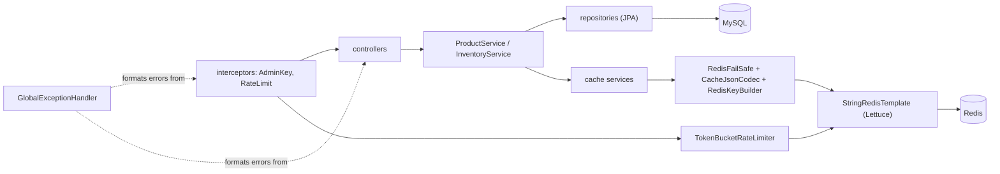
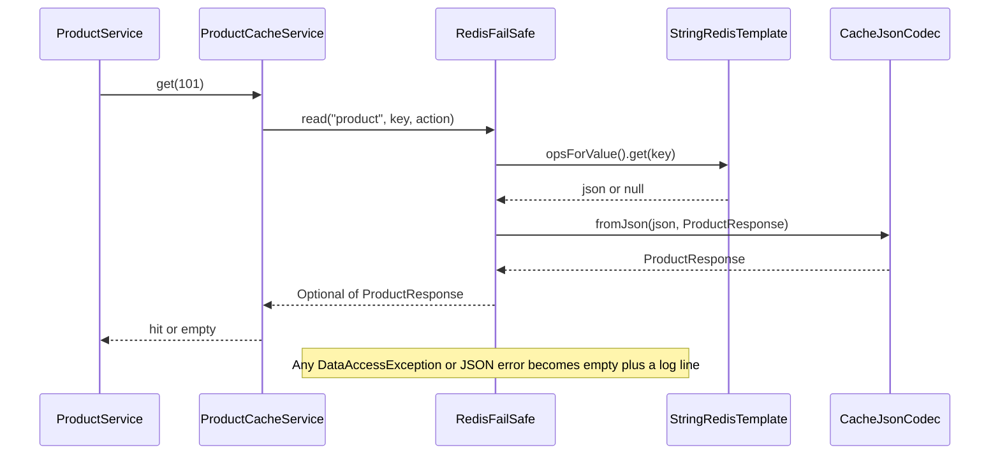

# IMPLEMENTATION.md — Technical Implementation Guide

> Part of the documentation set: [`PROJECT.md`](PROJECT.md) · **`IMPLEMENTATION.md`** · [`FLOW.md`](FLOW.md) · [`ROADMAP.md`](ROADMAP.md) · [`API.md`](API.md)
> This is a **guide**, not the application. Code snippets exist only where they clarify a design. Decision tags: **[Confirmed]**, **[Resolved R-xx]**, **[Open O-xx]** ([register](PROJECT.md#17-decision-register)). Stage numbers refer to [ROADMAP.md](ROADMAP.md).

## 1. Spring Boot project setup

| Setting | Value |
|---|---|
| Name / artifact | `redis-engineering-lab` |
| Group / base package | `com.redislab` |
| Java / build / packaging | 21 / Maven / JAR |
| Spring Boot | latest 3.5.x patch at creation, pinned ([O-10]) |
| Port | 8080 |
| Profiles | `application.yml` (common) + `application-dev.yml` (local) **[Confirmed]** |

### 1.1 Maven dependencies

| Dependency (artifactId) | Why | Added in |
|---|---|---|
| `spring-boot-starter-web` | REST | Stage 1 |
| `spring-boot-starter-data-redis` | Redis + Lettuce | Stage 1 |
| `spring-boot-starter-data-jpa` | MySQL access | Stage 1 |
| `mysql-connector-j` (runtime) | JDBC driver | Stage 1 |
| `flyway-core` **and `flyway-mysql`** | Migrations; Flyway 10+ needs the MySQL module separately ([R-28]) | Stage 1 |
| `spring-boot-starter-validation` | Bean Validation | Stage 1 |
| `spring-boot-starter-actuator` | Health | Stage 1 |
| `springdoc-openapi-starter-webmvc-ui` (2.8.x) | Swagger UI | Stage 4 |
| `spring-boot-starter-test` | JUnit 5, Mockito, AssertJ | Stage 1 |
| `spring-boot-testcontainers`, `org.testcontainers:junit-jupiter`, MySQL Testcontainers module | Real MySQL/Redis in tests (module names depend on the Testcontainers version in Boot's BOM — take them from the BOM) | Stage 1 (used Stage 9) |
| `awaitility` (test) | Waiting in time-based tests | Stage 8 |

Not added: Lombok (records and plain classes keep the code beginner-readable), `commons-pool2` (no pooling [Confirmed]), Spring Security (excluded [Confirmed]), `spring-boot-starter-cache` (Phase 2 optional).

## 2. Package structure

```
com.redislab
├── RedisEngineeringLabApplication.java
├── config/                 RedisConfig, WebConfig (registers interceptors), AppProperties, OpenApiConfig, JacksonConfig (if needed)
├── common/
│   ├── exception/          AppException base + ProductNotFound, InventoryNotFound, InsufficientStock,
│   │                       StockLimitExceeded, ConcurrentModification, InvalidAdminKey, RateLimitExceeded, GlobalExceptionHandler
│   ├── response/           ErrorResponse, PageResponse<T>
│   ├── security/           AdminKeyInterceptor
│   └── util/               ClientIpResolver
├── product/
│   ├── controller/         ProductController (public), AdminProductController
│   ├── service/            ProductService
│   ├── repository/         ProductRepository
│   ├── entity/             Product, ProductStatus
│   └── dto/                CreateProductRequest, UpdateProductRequest, ProductResponse, AdminProductResponse, ProductStatusResponse
├── inventory/
│   ├── controller/         InventoryController (public), AdminInventoryController
│   ├── service/            InventoryService
│   ├── repository/         InventoryRepository
│   ├── entity/             Inventory
│   └── dto/                SetInventoryRequest, QuantityRequest, InventoryResponse, AdminInventoryResponse
├── cache/
│   ├── key/                RedisKeyBuilder
│   ├── service/            ProductCacheService, InventoryCacheService, ProductListCacheService
│   └── support/            CacheJsonCodec, RedisFailSafe
├── ratelimit/
│   ├── RateLimitInterceptor, TokenBucketRateLimiter, RateLimitResult, RateLimitProperties
│   └── (resource) redis/token_bucket.lua
└── redis/                  DEV ONLY: RedisSandboxService, RedisSandboxController (@Profile("dev"))
```

Packages are created only when their stage starts **[Confirmed]**. Reconciliation of earlier layouts (`config/RedisConfig` vs `cache/config`; `redis/` sandbox) is [R-21].



Dependency rule: controllers → services → (repositories, cache services). **Controllers never touch Redis; business services never issue raw Redis commands; cache services never call repositories.** `ratelimit` and `cache` do not depend on `product`/`inventory`.

## 3. Docker Compose setup

File: `ops/compose.dev.yml`. Environment values come from a Git-ignored `.env` (commit only `.env.example`).

```yaml
name: redis-engineering-lab
services:
  mysql:
    image: mysql:8.0
    container_name: redislab-mysql
    environment:
      MYSQL_DATABASE: redis_engineering_lab
      MYSQL_USER: ${MYSQL_USER}
      MYSQL_PASSWORD: ${MYSQL_PASSWORD}
      MYSQL_ROOT_PASSWORD: ${MYSQL_ROOT_PASSWORD}
    command: ["--default-time-zone=+00:00", "--character-set-server=utf8mb4"]
    ports: ["127.0.0.1:3306:3306"]
    volumes: ["mysql_data:/var/lib/mysql"]
    healthcheck:
      test: ["CMD", "mysqladmin", "ping", "-h", "localhost"]
      interval: 10s
      retries: 10
  redis:
    image: redis:7.2
    container_name: redislab-redis
    command: ["redis-server", "--maxmemory", "128mb", "--maxmemory-policy", "noeviction",
              "--save", "", "--appendonly", "no"]
    ports: ["127.0.0.1:6379:6379"]
    mem_limit: 192m
    healthcheck:
      test: ["CMD", "redis-cli", "ping"]
      interval: 5s
volumes:
  mysql_data:
```

Run: `docker compose -f ops/compose.dev.yml --env-file .env up -d`.

| Choice | Reason |
|---|---|
| MySQL volume | Data survives restarts; Redis deliberately has no volume/persistence **[Confirmed]** |
| `127.0.0.1` binding | Redis has no password in the lab ([R-32]) |
| `--default-time-zone=+00:00` | `CURRENT_TIMESTAMP(6)` in native SQL must be UTC ([R-28]) |
| `mem_limit 192m` vs `maxmemory 128mb` | Headroom for Redis overhead/fragmentation **[Confirmed]** |

`.env.example`: `MYSQL_USER`, `MYSQL_PASSWORD`, `MYSQL_ROOT_PASSWORD`, `ADMIN_API_KEY` — all placeholders.

## 4. Application configuration files

`application.yml` (common):

```yaml
spring:
  application.name: redis-engineering-lab
  jpa:
    open-in-view: false                 # R-28: no lazy loading in controllers
    hibernate.ddl-auto: validate        # Flyway owns the schema [Confirmed]
    properties.hibernate.jdbc.time_zone: UTC
  flyway.enabled: true
  sql.init.mode: never
  data.redis:
    host: localhost
    port: 6379
    database: 0
    timeout: 1s                         # command timeout [Confirmed]
    connect-timeout: 2s                 # [Confirmed]
    # no lettuce.pool.* => shared connection, no pooling [Confirmed]
management:
  endpoints.web.exposure.include: health
  endpoint.health:
    show-details: never                 # only UP / DOWN [Confirmed]
    show-components: always
app:
  environment: dev
  admin.api-key: ${ADMIN_API_KEY}       # no default: startup fails if missing [R-26]
  redis:
    project: redis-lab
    ttl: { product: PT15M, inventory: PT30S, product-list: PT15M }
  rate-limit:
    enabled: true
    capacity: 10
    refill-tokens-per-second: 1
    key-ttl-after-full: PT60S
    trust-forwarded-headers: false
  pagination: { default-size: 20, max-size: 50 }
  inventory.max-stock-quantity: 1000000000
```

`application-dev.yml`: datasource (`jdbc:mysql://localhost:3306/redis_engineering_lab?connectionTimeZone=UTC&forceConnectionTimeZoneToSession=true`, user/password from env), `springdoc` enabled, `app.dev-endpoints.enabled: true`, SQL logging / Hibernate statistics (to *count* MySQL calls), `logging.level.com.redislab: DEBUG`. Outside `dev`, Springdoc and the sandbox are off.

Typed binding: one `@ConfigurationProperties("app")` + `@Validated` record tree in `config/AppProperties` (`@NotBlank` on the admin key). TTLs and prefix are **never** hard-coded in services.

## 5. MySQL configuration

- MySQL 8.0, database `redis_engineering_lab`, UTF-8 (`utf8mb4`), default isolation `REPEATABLE READ`.
- HikariCP default pool (JDBC pooling is unrelated to the *Redis* "no pool" decision).
- All timestamps `DATETIME(6)` in UTC; entities use `java.time.Instant`.

## 6. Flyway migrations

`src/main/resources/db/migration/` ([R-23]):

**`V1__create_products_table.sql`**

```sql
CREATE TABLE products (
    id          BIGINT AUTO_INCREMENT PRIMARY KEY,
    name        VARCHAR(100)  NOT NULL,
    description VARCHAR(500),
    price       DECIMAL(10,2) NOT NULL,
    status      VARCHAR(20)   NOT NULL DEFAULT 'ACTIVE',
    version     BIGINT        NOT NULL DEFAULT 0,
    created_at  DATETIME(6)   NOT NULL,
    updated_at  DATETIME(6)   NOT NULL,
    CONSTRAINT chk_product_price  CHECK (price > 0),
    CONSTRAINT chk_product_status CHECK (status IN ('ACTIVE','INACTIVE'))
);
```

**`V2__create_inventory_table.sql`**

```sql
CREATE TABLE inventory (
    id             BIGINT AUTO_INCREMENT PRIMARY KEY,
    product_id     BIGINT      NOT NULL UNIQUE,
    stock_quantity INT         NOT NULL DEFAULT 0,
    version        BIGINT      NOT NULL DEFAULT 0,
    created_at     DATETIME(6) NOT NULL,
    updated_at     DATETIME(6) NOT NULL,
    CONSTRAINT chk_inventory_quantity CHECK (stock_quantity >= 0),
    CONSTRAINT fk_inventory_product FOREIGN KEY (product_id) REFERENCES products(id) ON DELETE RESTRICT
);
```

**`V3__add_product_indexes.sql`**

```sql
CREATE INDEX idx_products_status_created ON products (status, created_at DESC, id DESC);
```

Indexes **[Confirmed]**: primary keys, `(status, created_at, id)` for the public list, unique `product_id`. The admin list (no status filter) sorts without a dedicated index; at lab sizes (≈10,000 rows) this is fine and an index would be added only if measured (Phase 5). Never edit an applied migration; add `V4…`.

## 7. JPA entities and repositories

### 7.1 Entities

| Entity | Key points |
|---|---|
| `Product` | `@Id @GeneratedValue(IDENTITY) Long id`; `name`, `description`, `BigDecimal price`; `@Enumerated(STRING) ProductStatus status`; **`@Version Long version`**; `Instant createdAt/updatedAt` set in `@PrePersist/@PreUpdate` |
| `Inventory` | `Long id`; **`Long productId`** (plain column, no JPA association — keeps queries explicit and beginner-simple); `int stockQuantity`; **`@Version Long version`**; timestamps |

`Product` exposes behavior (`rename…`, `changeStatus`) instead of only setters, and a method `hasSameEditableValues(name, description, price)` using `price.compareTo(...) == 0` ([R-17]).

### 7.2 Repositories

| Method | Purpose |
|---|---|
| `ProductRepository.findByIdAndStatus(id, ACTIVE)` | public detail |
| `ProductRepository.findByStatus(ACTIVE, Pageable)` | public list; `Pageable` sort = `createdAt DESC, id DESC` |
| `ProductRepository.findAll(Pageable)` | admin list |
| `InventoryRepository.findByProductId(id)` | admin read / set |
| `InventoryRepository.findPublicByProductId(id)` | JPQL join with `Product` where `status = ACTIVE`, returns projection (`productId`, `stockQuantity`) |
| `InventoryRepository.existsByProductId(id)` | disambiguate 404 vs 409 |
| `InventoryRepository.increment(...)` / `decrement(...)` | atomic `@Modifying` queries (below) |

```java
@Modifying(clearAutomatically = true, flushAutomatically = true)
@Query(value = """
    UPDATE inventory
       SET stock_quantity = stock_quantity + :q, version = version + 1, updated_at = CURRENT_TIMESTAMP(6)
     WHERE product_id = :productId AND stock_quantity <= :max - :q
    """, nativeQuery = true)
int increment(long productId, int q, int max);

@Modifying(clearAutomatically = true, flushAutomatically = true)
@Query(value = """
    UPDATE inventory
       SET stock_quantity = stock_quantity - :q, version = version + 1, updated_at = CURRENT_TIMESTAMP(6)
     WHERE product_id = :productId AND stock_quantity >= :q
    """, nativeQuery = true)
int decrement(long productId, int q);
```

Considerations: the `version` column is bumped **by hand** in native SQL ([R-06]); `clearAutomatically` prevents stale entities in the persistence context; read the row again **in the same transaction** (it holds the row lock, so the value read is exactly the result of this update).

## 8. DTOs and validation

All DTOs are Java records. Jakarta Bean Validation produces the `fieldErrors` map.

| DTO | Fields & rules |
|---|---|
| `CreateProductRequest` | `name` `@NotBlank @Size(3,100)` ("Name is required" / "Name must be 3–100 characters"); `description` `@Size(max=500)`; `price` `@NotNull @DecimalMin(value="0.00", inclusive=false) @DecimalMax("99999999.99") @Digits(integer=8, fraction=2)` |
| `UpdateProductRequest` | same three fields, all required + `version` `@NotNull` |
| `SetInventoryRequest` | `stockQuantity` `@NotNull @Min(0) @Max(1_000_000_000)`; `version` `@NotNull` |
| `QuantityRequest` (increment/decrement) | `quantity` `@NotNull @Min(1) @Max(1_000_000_000)` |
| `ProductResponse` (public, cached) | `id, name, description, price, status` |
| `AdminProductResponse` | + `version` |
| `ProductStatusResponse` | `id, status, version` ([R-05]) |
| `InventoryResponse` (public, cached) | `productId, stockQuantity` |
| `AdminInventoryResponse` | `productId, stockQuantity, version` |
| `PageResponse<T>` | `content, page, size, totalElements, totalPages, last` — custom, never Spring's `Page` **[Confirmed]** |
| `ErrorResponse` | `timestamp, status, code, message, path, fieldErrors?` (`@JsonInclude(NON_NULL)`) |

Pagination: `PageRequestValidator` (in `common/util`) checks `page ≥ 0` and `1 ≤ size ≤ max`, throwing a pagination exception → `INVALID_PAGINATION`. Service-level checks (existence, version) are business rules, not bean validation.

## 9. Services and controllers

### 9.1 Responsibilities

| Class | Responsibility |
|---|---|
| Controllers | Map URL → service; apply `@Valid`; no business logic, no Redis, no transactions |
| `ProductService` | Create/update/status/read rules; transactions; calls cache services |
| `InventoryService` | Stock rules; atomic updates; calls `InventoryCacheService` |
| Cache services | One Redis key family each; JSON + TTL + fail-open ([§15](#15-cache-layer)) |
| `GlobalExceptionHandler` | Single place that turns exceptions into JSON |

### 9.2 Transaction and invalidation pattern

**Problem [R-07]:** with `@Transactional` on a service method, anything written *inside* the method (including a Redis delete) runs **before** the commit. Invalidating there breaks the rule "never invalidate for a transaction that might roll back", and a concurrent reader can re-cache the old row between the delete and the commit.

**Solution:** `ProductService`/`InventoryService` are **not** `@Transactional`. They use an injected `TransactionTemplate` for the database part and invalidate after it returns:

```java
public AdminProductResponse updateProduct(long id, UpdateProductRequest req) {
    UpdateOutcome outcome = tx.execute(status -> doUpdateInMySql(id, req));   // commit happens here
    if (outcome.changed()) {
        productCache.evict(id);          // after commit, fail-open
        productListCache.evictAll();
    }
    return outcome.response();
}
```

(An equivalent alternative is `@TransactionalEventListener(AFTER_COMMIT)`; `TransactionTemplate` was chosen because the order is visible in the code.) Read methods use `@Transactional(readOnly = true)` on the repository calls or a read-only template.

### 9.3 Product service rules (summary)

1. **Create:** trim name; in tx insert product (`ACTIVE`) + inventory (0); after commit `evictAll()`.
2. **Update:** load → `404`; `req.version != entity.version` → `409`; unchanged → return as is; else apply, save (Hibernate adds `AND version=?`), `ObjectOptimisticLockingFailureException` → `409`; after commit evict product + lists.
3. **Activate/deactivate:** load → `404`; same status → return; else change status; after commit evict product, inventory, lists.
4. **Public read:** cache → MySQL (`findByIdAndStatus`) → `404` or cache + return.
5. **Public list / admin list / admin detail:** as in [FLOW.md §8](FLOW.md#8-paginated-product-listing).

### 9.4 Inventory service rules (summary)

1. **Public read:** cache → `findPublicByProductId` (join, ACTIVE only) → `404 INVENTORY_NOT_FOUND` or cache (30 s) + return.
2. **Admin read:** `findByProductId`, never cached.
3. **Set:** load → `404`; version mismatch → `409`; same quantity → return unchanged; else save (`@Version`); after commit evict `inventory:{id}`.
4. **Increment/Decrement:** atomic query inside one transaction; 1 row → re-read; 0 rows → `existsByProductId` decides `404` vs `409` (`INSUFFICIENT_STOCK` or `STOCK_LIMIT_EXCEEDED`); after commit evict.

## 10. Admin API-key authentication

| Item | Design |
|---|---|
| What | Static key in header `X-Admin-Key` **[Confirmed]** |
| Why | Simulates protected writes without JWT/Spring Security (out of scope) |
| How | `AdminKeyInterceptor implements HandlerInterceptor`, registered in `WebConfig` for `/api/admin/**` and `/api/dev/**` ([R-08]); `preHandle` reads the header, compares with `MessageDigest.isEqual(bytes, bytes)` (constant time), throws `InvalidAdminKeyException` if missing/wrong |
| Why an interceptor, not a servlet filter | Exceptions thrown from filters occur *before* Spring MVC and do **not** reach `@RestControllerAdvice`; interceptors do |
| Config | `app.admin.api-key` bound from env `ADMIN_API_KEY`, `@NotBlank` → the app **fails to start** if empty ([R-26]) |
| Never | Hard-code, commit, log the key, or echo it in errors |
| Expected | Missing/wrong key → `401 INVALID_ADMIN_KEY` before any validation or DB access |

## 11. Global exception handling

`@RestControllerAdvice GlobalExceptionHandler` builds `ErrorResponse` (UTC timestamp, `request.getRequestURI()` as `path`).

| Exception | Status | Code |
|---|---|---|
| `MethodArgumentNotValidException` | 400 | `VALIDATION_FAILED` (+ `fieldErrors`: field → message, all fields) |
| `HttpMessageNotReadableException` | 400 | `MALFORMED_REQUEST` |
| `MethodArgumentTypeMismatchException` | 400 | `INVALID_PAGINATION` if parameter is `page`/`size`, else `INVALID_PARAMETER` |
| `InvalidPaginationException` | 400 | `INVALID_PAGINATION` |
| `InvalidAdminKeyException` | 401 | `INVALID_ADMIN_KEY` |
| `ProductNotFoundException` / `InventoryNotFoundException` | 404 | `PRODUCT_NOT_FOUND` / `INVENTORY_NOT_FOUND` |
| `NoResourceFoundException` / `HttpRequestMethodNotSupportedException` / `HttpMediaTypeNotSupportedException` | 404 / 405 / 415 | `ENDPOINT_NOT_FOUND` / `METHOD_NOT_ALLOWED` / `UNSUPPORTED_MEDIA_TYPE` ([R-25]) |
| `ConcurrentModificationException`, `ObjectOptimisticLockingFailureException` | 409 | `CONCURRENT_MODIFICATION` |
| `InsufficientStockException` | 409 | `INSUFFICIENT_STOCK` |
| `StockLimitExceededException` | 409 | `STOCK_LIMIT_EXCEEDED` |
| `RateLimitExceededException` | 429 | `RATE_LIMIT_EXCEEDED`; handler copies `Retry-After` and `X-RateLimit-*` from the carried `RateLimitResult` |
| `RedisSandboxKeyNotFound` / `RedisUnavailableException` (dev only) | 404 / 503 | `REDIS_KEY_NOT_FOUND` / `REDIS_UNAVAILABLE` |
| `Exception` (fallback) | 500 | `INTERNAL_SERVER_ERROR`, generic message; **stack trace logged, never returned** |

Business exceptions extend one `AppException(status, code, message)` so most handlers are a single method.

## 12. Redis connection using Spring Data Redis and Lettuce

| What | Redis connectivity with timeouts and reconnection |
|---|---|
| Why | An outage must not freeze or crash requests |
| Internals | One thread-safe Lettuce `StatefulRedisConnection` shared by all threads (no pool [Confirmed]); Netty I/O; auto-reconnect with backoff |
| Class | `config/RedisConfig` |

```java
@Bean
LettuceClientConfigurationBuilderCustomizer lettuceCustomizer() {
    return builder -> builder
        .commandTimeout(Duration.ofSeconds(1))                                   // [Confirmed]
        .clientOptions(ClientOptions.builder()
            .autoReconnect(true)                                                 // [Confirmed]
            .disconnectedBehavior(ClientOptions.DisconnectedBehavior.REJECT_COMMANDS) // [R-10]
            .socketOptions(SocketOptions.builder().connectTimeout(Duration.ofSeconds(2)).build())
            .timeoutOptions(TimeoutOptions.enabled(Duration.ofSeconds(1)))
            .build());
}
```

**[R-10] correction:** with auto-reconnect and Lettuce's *default* disconnected behavior, commands issued while Redis is down are **queued** and only fail when the 1 s timeout fires — every request would be delayed ~1 s. `REJECT_COMMANDS` makes them fail instantly while disconnected, so MySQL fallback is fast. Verify in Stage 2 and Stage 9 by stopping the Redis container and timing requests.

Expected: app starts even if Redis is down (Lettuce connects lazily); `redis-cli` and the app both see DB 0.

## 13. RedisTemplate and JSON serialization

**Why serialization matters:** a plain `RedisTemplate<Object,Object>` uses **JDK serialization**, which writes binary keys/values like `\xac\xed\x00\x05t\x00…`. This is the unreadable data seen earlier in KINNOTE. Stage 2 demonstrates it once (write with a JDK template, inspect with `redis-cli`) and then switches to the project design.

**Design [R-09]:**

| Concern | Decision |
|---|---|
| Template | Boot's auto-configured **`StringRedisTemplate`** (keys and values are `String`) for *everything*: cache, Lua scripts, sandbox |
| JSON | `CacheJsonCodec` uses Boot's `ObjectMapper` (already has the Java-time module) to produce/parse JSON text explicitly |
| Not used | `GenericJackson2JsonRedisSerializer` with default typing — it injects `"@class": "com.redislab…"` into every value, which breaks readability and fails after a class is renamed/moved (stale cached entries would crash deserialization) |
| Lua arguments | Must be plain strings. A JSON value serializer would send `"10"` **with quotes**, and `tonumber('"10"')` is `nil` — the reason Lua uses `StringRedisTemplate` |

Values stay readable (`redis-cli GET redis-lab:dev:product:101` prints the JSON of [PROJECT.md §10.3](PROJECT.md#103-cached-value-formats-confirmed--plain-readable-json)). `BigDecimal` keeps its scale (`799.00`).

## 14. Basic Redis commands (Stage 2)

Dev-only sandbox ([API.md §6](API.md#6-development-only-redis-learning-endpoints)): `redis/RedisSandboxService` + `RedisSandboxController` (`@Profile("dev")`, behind the admin interceptor, keys prefixed `redis-lab:dev:sandbox:`).

| Redis CLI | Java (`StringRedisTemplate`) | Sandbox endpoint |
|---|---|---|
| `SET k v [EX s]` | `opsForValue().set(k, v[, Duration])` | `POST /api/dev/redis/keys` |
| `GET k` | `opsForValue().get(k)` | `GET …/keys/{key}` |
| `DEL k` | `delete(k)` | `DELETE …/keys/{key}` |
| `EXISTS k` | `hasKey(k)` | `GET …/{key}/exists` |
| `EXPIRE k s` | `expire(k, Duration)` | `POST …/{key}/expire` |
| `TTL k` | `getExpire(k, TimeUnit.SECONDS)` | `GET …/{key}/ttl` |

Learning habit (every stage): perform an action via the API, then inspect with `docker exec -it redislab-redis redis-cli` — `GET`, `TTL`, `TYPE`, `HGETALL`, `SCAN 0 MATCH redis-lab:dev:* COUNT 100`, `INFO memory`. **Never `KEYS *`** in shared environments.

Expected: Java-created keys appear in the CLI as readable text; TTLs count down; DEL and expiry make GET return `nil`/`404`.

## 15. Cache layer

**What:** `cache/` module — the only code that knows Redis key formats and commands for business data.

| Class | Responsibility |
|---|---|
| `RedisKeyBuilder` | `product(id)`, `inventory(id)`, `productPage(page,size)`, `productPagePattern()`, `rateLimit(ip)`, `sandbox(key)`; prefix = `${project}:${environment}:` from `AppProperties` |
| `CacheJsonCodec` | object ↔ JSON string |
| `RedisFailSafe` | wraps every Redis call: catches `DataAccessException` (covers `RedisConnectionFailureException`, `QueryTimeoutException` for 1 s timeouts, OOM errors) → logs → returns "empty/ignored" |
| `ProductCacheService` | `Optional<ProductResponse> get(id)`, `put(response)`, `evict(id)` (TTL from config) |
| `InventoryCacheService` | same for `InventoryResponse` |
| `ProductListCacheService` | `get(page,size)`, `put(page,size,PageResponse)`, `evictAll()` |

How a cache read travels through the classes:



Behavior contract of **every** cache method: it **never throws** to the caller for Redis or JSON problems. Reads return empty, writes/evicts do nothing, and the event is logged:

| Log event | When |
|---|---|
| `CACHE_HIT key=…` / `CACHE_MISS key=…` | normal read results (DEBUG/INFO) |
| `CACHE_READ_FAILED`, `CACHE_WRITE_FAILED`, `CACHE_INVALIDATE_FAILED` | Redis error (WARN, with exception class) |
| `CACHE_CORRUPT_ENTRY key=…` | JSON cannot be parsed → entry deleted and treated as miss ([R-27]) |

## 16. Cache-aside implementation

```java
public ProductResponse getPublicProduct(long id) {
    return productCache.get(id)                                   // Redis GET (fail-open)
        .orElseGet(() -> {
            Product p = productRepository.findByIdAndStatus(id, ACTIVE)
                .orElseThrow(() -> new ProductNotFoundException(id));   // 404, nothing cached
            ProductResponse dto = ProductResponse.from(p);
            productCache.put(dto);                                // SET key json EX 900 (fail-open)
            return dto;
        });
}
```

Same shape for inventory (30 s) and the list (15 min). Cache write uses a single `SET … EX` (atomic value + TTL), never `SET` then `EXPIRE`. **Phase 1 has no stampede protection** ([R-31]: a Stage 9 test fires many parallel requests at an empty cache and counts MySQL queries to *prove* the problem; the fix is Stage 2.1).

List-specific rules: key `products:page:{page}:size:{size}`; skip cache write for an empty page with `page > 0` so arbitrary page numbers cannot fill the 128 MB `noeviction` Redis with junk keys ([R-15]).

## 17. TTL implementation

TTLs are configuration (`app.redis.ttl.*`), converted to `Duration`, passed to `set(key, value, Duration)`.

| Cache | TTL | Config key |
|---|---|---|
| Product | 15 min | `product` |
| Product list | 15 min | `product-list` |
| Inventory | 30 s | `inventory` |
| Rate-limit bucket | seconds-to-full + 60 s | computed in Lua |

TTL jitter (random ± seconds to de-synchronize expiry) is **not** in Phase 1; it is a Phase 2 stampede-mitigation option.

## 18. Cache invalidation

Implemented as in the [matrix](FLOW.md#121-invalidation-matrix-authoritative). Details:

- `evict(id)` → `DEL` (or `UNLINK`) of one key.
- `evictAll()` for lists → cursor loop `SCAN … MATCH <prefix>products:page:* COUNT 100` → `UNLINK` each batch ([R-14]). Use `RedisCallback`/`scan(ScanOptions)` and **close the cursor** (try-with-resources).
- `UNLINK`/`DEL` are still allowed when Redis is out of memory, so invalidation keeps working under `noeviction`.
- Called only **after** commit ([§9.2](#92-transaction-and-invalidation-pattern)), only when something changed, each wrapped in `RedisFailSafe`.

## 19. Redis failure fallback

| Layer | Behavior | Class |
|---|---|---|
| Timeouts | connect 2 s, command 1 s | `RedisConfig` |
| Disconnected | commands rejected instantly | `RedisConfig` ([R-10]) |
| Cache read error | miss → MySQL | cache services via `RedisFailSafe` |
| Cache write/evict error | log, continue | same |
| Rate limiter error | allow request, log, omit headers | `RateLimitInterceptor` |
| Sandbox | `503 REDIS_UNAVAILABLE` | `RedisSandboxService` |
| Retries | none in app code **[Confirmed]** | – |
| Reconnect | Lettuce automatic **[Confirmed]** | – |

Subtle point **[Confirmed]**: "automatic reconnection restores connectivity, not lost data" — after a Redis restart the cache is empty and refills lazily.

Known limit (accepted, [R-24]): if invalidation fails while Redis is reachable-but-erroring, the old value lives until TTL. A circuit breaker (to stop attempting Redis for a few seconds after repeated failures) is a Phase 4/5 optional experiment.

## 20. Token bucket rate limiter

### 20.1 Overview

| What | Per-IP token bucket protecting public reads |
|---|---|
| Why | Control request rates across all instances; learn Lua + atomicity |
| Parameters | capacity 10, refill 1/s, 1 token per request, shared bucket, `EXPIRE = secondsToFull + 60` **[Confirmed]** |
| Classes | `RateLimitInterceptor`, `TokenBucketRateLimiter`, `RateLimitResult(allowed, remaining, retryAfterSeconds, resetEpochSeconds)`, `ClientIpResolver`, resource `redis/token_bucket.lua` |
| Registered for | `GET /api/products`, `/api/products/*`, `/api/inventory/*` (not admin, actuator, swagger, dev) ([R-02]) |

### 20.2 Redis Hash usage

The bucket is a **Hash** because it has two related fields updated together:

```
HGETALL redis-lab:dev:rate-limit:127.0.0.1
1) "tokens"            2) "7.4"
3) "last_refill_time"  4) "1793880000123"     (epoch milliseconds from Redis TIME)
```

Why not two String keys: updating two keys is not one atomic step and doubles keys to expire. Why not `INCR` + `EXPIRE` (fixed window): it allows 2× bursts at window edges and gives no refill. `tokens` is stored as text because it can be fractional (e.g., 7.4).

### 20.3 Lua script

`src/main/resources/redis/token_bucket.lua`:

```lua
-- KEYS[1] bucket key
-- ARGV[1] capacity, ARGV[2] refill tokens/second, ARGV[3] tokens requested, ARGV[4] seconds to keep key after full
local capacity    = tonumber(ARGV[1])
local refill_rate = tonumber(ARGV[2])
local requested   = tonumber(ARGV[3])
local ttl_after   = tonumber(ARGV[4])

local t = redis.call('TIME')
local now_ms = tonumber(t[1]) * 1000 + math.floor(tonumber(t[2]) / 1000)

local data   = redis.call('HMGET', KEYS[1], 'tokens', 'last_refill_time')
local tokens = tonumber(data[1])
local last   = tonumber(data[2])
if tokens == nil or last == nil then
  tokens = capacity
  last   = now_ms
end

local elapsed = math.max(0, now_ms - last)
tokens = math.min(capacity, tokens + (elapsed / 1000) * refill_rate)

local allowed, retry_after = 0, 0
if tokens >= requested then
  tokens  = tokens - requested
  allowed = 1
else
  retry_after = math.ceil((requested - tokens) / refill_rate)
end

local seconds_to_full = math.ceil((capacity - tokens) / refill_rate)
redis.call('HSET', KEYS[1], 'tokens', tostring(tokens), 'last_refill_time', now_ms)
redis.call('EXPIRE', KEYS[1], seconds_to_full + ttl_after)

return { allowed, math.floor(tokens), retry_after, math.floor(now_ms / 1000) + seconds_to_full }
```

Notes: Using Redis `TIME` inside a script is safe on Redis ≥ 5 (script *effects* are replicated) — the lab uses 7.2 ([R-11]). The script touches only `KEYS[1]` (cluster-safe habit). A rejected request still stores the refilled token count. Under `noeviction` + full memory the `HSET` raises an OOM error → limiter fails open.

### 20.4 Java side

```java
private static final DefaultRedisScript<List> SCRIPT =
    new DefaultRedisScript<>(loadResource("redis/token_bucket.lua"), List.class);

List<Long> r = stringRedisTemplate.execute(SCRIPT, List.of(key),
        "10", "1", "1", "60");        // plain strings => see §13
```

`TokenBucketRateLimiter.tryConsume(ip)` maps the 4-element list to `RateLimitResult` and **catches `DataAccessException`** → returns `Optional.empty()` (fail-open signal).

### 20.5 Interceptor and headers

1. `ClientIpResolver`: default `request.getRemoteAddr()`; use the first `X-Forwarded-For` entry **only if** `app.rate-limit.trust-forwarded-headers=true` (set when running behind a trusted reverse proxy; otherwise clients could spoof the header to get unlimited buckets) ([R-20]). Replace `:` (IPv6) with `_` in the key.
2. `preHandle`: call limiter. Empty (Redis failure) → log `RATE_LIMIT_REDIS_FAILURE`, return `true`, set no headers. Present → always set `X-RateLimit-Limit/Remaining/Reset`; if not allowed → log `RATE_LIMIT_REJECTED ip=…` and throw `RateLimitExceededException(result)`.
3. `GlobalExceptionHandler` writes the 429 JSON and `Retry-After`.
4. The interceptor runs *before* parameter validation, so a request with an invalid `size` still consumes a token (by design, simple and safe).

Expected behavior: 10 immediate requests pass (`Remaining` 9 → 0), the 11th gets `429`; one second later one request passes; the Redis key disappears ~60 s after the bucket would be full.

## 21. Unit and integration testing

### 21.1 Test levels **[Confirmed]**

| Level | Tools | Scope |
|---|---|---|
| Unit | JUnit 5, Mockito | Service rules with mocked repositories and cache services; validation; `ClientIpResolver`; `RedisKeyBuilder`; `CacheJsonCodec` |
| Integration | `@SpringBootTest` + Testcontainers (MySQL 8.0 + Redis 7.2) | Real SQL, Flyway, real Redis, real Lua |
| Load | k6 or JMeter ([O-04]) | Phase 5; simple concurrency tests earlier |

Containers are wired with `@ServiceConnection` in a shared `TestcontainersConfig`; the Redis container is a `GenericContainer("redis:7.2")` with `@ServiceConnection(name = "redis")`. Docker must be running. Test environment prefix = `test` so keys never collide with `dev`.

### 21.2 Required scenarios

| Area | Scenario (all in Stage 9 unless noted) |
|---|---|
| Cache-aside | first GET = miss, second = hit (assert no 2nd SQL via Hibernate statistics), TTL ≈ 900 s / 30 s via `redisTemplate.getExpire` |
| Invalidation | update product → product key + list pages gone; deactivate → three key families gone; unchanged update/repeated activate → keys **kept**; inventory writes → only inventory key |
| Not-found | 404 not cached; inactive → 404 |
| Pagination | size 51 → 400; page past end → empty 200 and **not cached**; sort order |
| Inventory concurrency | stock 5, 100 parallel decrements of 1 → exactly 5 succeed, 95 × `409`, final 0; parallel increments sum correctly; stale `version` → 409 |
| Optimistic locking | two PUTs with same version → one 200, one 409 |
| Create | transaction rollback leaves no orphan product (force inventory failure) |
| Rate limiter | 10 pass, 11th `429` + `Retry-After`; refill after ≈1 s (Awaitility); bucket TTL set; 50 parallel requests → allowed count ≈ 10 (+ refill during the run); headers present |
| Limiter shared | product + inventory + list calls draw from one bucket |
| Redis failure | start the app against an unreachable Redis port: reads return 200 from MySQL, writes return success, limiter allows, no request exceeds a small latency bound (validates [R-10]); manual `docker compose stop redis` run in Stage 9 |
| Serialization | cache value is readable JSON without `@class`; corrupt value → miss + deleted ([R-27]) |
| Admin key | missing/wrong → 401 on every admin and dev endpoint; app refuses empty key |
| Error format | every error has `timestamp,status,code,message,path`; 500 never leaks details |
| Stampede (reproduce) | empty cache + 50 parallel GETs → MySQL select count > 1 (documents the problem for Stage 2.1) |
| Health | `/actuator/health` overall `UP` with Redis stopped, `redis` component not `UP` ([R-12]) |

Time-based tests wait on real Redis time (Lua uses Redis `TIME`), so use short sleeps or Awaitility instead of mocking a Java clock.

## 22. Actuator and logging

### Health **[Confirmed + R-12]**

- Exposure: only `health`; `show-details: never`, `show-components: always` → statuses only.
- **Correction:** Spring Boot's default aggregation makes the overall status `DOWN` if *any* component is down, which contradicts "the application stays UP when Redis is down". Resolution: Redis is a **non-critical** dependency. Provide a custom `RedisHealthIndicator` (bean name `redis`, replacing the auto-configured one via `management.health.redis.enabled=false`) that pings Redis and reports `UP`, or on failure a custom status `DEGRADED`; configure `management.endpoint.health.status.order=DOWN,OUT_OF_SERVICE,UP,UNKNOWN` (statuses not listed are ignored by the simple aggregator) and `status.http-mapping.DEGRADED=200`. MySQL (`db`) stays critical.
- **Stage 2/9 acceptance check:** stop Redis → overall `UP` (HTTP 200), `redis` ≠ `UP`; stop MySQL → overall `DOWN` (503). If the Boot version in use aggregates differently, fall back to a health **group** `readiness` that includes only `db` and use `/actuator/health/readiness` as the availability signal, keeping the intent.
- No connection strings, hosts or credentials in any response.

### Logging

Plain structured text (`EVENT key=value`). Events: `CACHE_HIT/MISS/READ_FAILED/WRITE_FAILED/INVALIDATE_FAILED/CORRUPT_ENTRY`, `RATE_LIMIT_REJECTED`, `RATE_LIMIT_REDIS_FAILURE`, `MYSQL_FALLBACK`. WARN for Redis failures, DEBUG for hit/miss in `dev`. Never log the admin key, request bodies with secrets, or stack traces in responses (stack traces only in the server log for 500s).

## 23. OpenAPI

Springdoc added in Stage 4: `OpenApiConfig` declares the `X-Admin-Key` security scheme so Swagger UI can send it; controllers carry short `@Operation` summaries and documented error responses; enabled only in `dev`.

## 24. Future implementation topics

| Phase | Topics (design hooks already in Phase 1) |
|---|---|
| 2 | `RedisLockService` (`SET NX PX`, token, compare-and-delete Lua) hooked into the cache-miss path; `Idempotency-Key` handling for increment/decrement; `RedisMessagePublisher` + `MessageListenerContainer` for `events:inventory`; optional retry policy; optional `@Cacheable` comparison ([O-03]) |
| 3 | `StreamProducer`, `StreamConsumer` (`XREADGROUP`, `XACK`, `XAUTOCLAIM`), second instance via `--server.port=8081`; Pub/Sub vs Streams comparison |
| 4 | Compose variants for RDB/AOF; eviction policies; `INFO`/`SLOWLOG` analysis; Micrometer + Prometheus + Grafana + Redis Exporter |
| 5 | Page-version cache keys experiment, delayed double-delete, load test scripts, performance report |

Hooks: `cache/` already isolates key formats; `RedisKeyBuilder` has reserved methods for `lock`, `idempotency`, `eventsChannel`, `stream` keys; the product miss path is a single method (`loadAndCache`) where the lock will wrap.

## 25. Known limitations (documented, not hidden)

1. Stale-write race and failed-invalidation staleness until TTL ([R-24]).
2. Rate limiter and caches fail open; limits can be bypassed during Redis outages/OOM.
3. Admin-key brute force not rate limited ([O-08]); static key is a lab simulation.
4. `SCAN`-based list invalidation is O(keyspace) and may miss keys added mid-scan.
5. Redis-only idempotency (Phase 2) is lossy because Redis has no persistence in Phase 1 ([O-02]).
