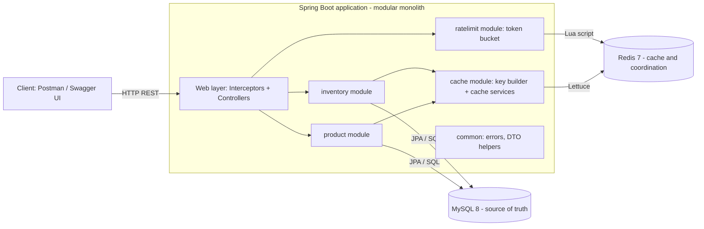
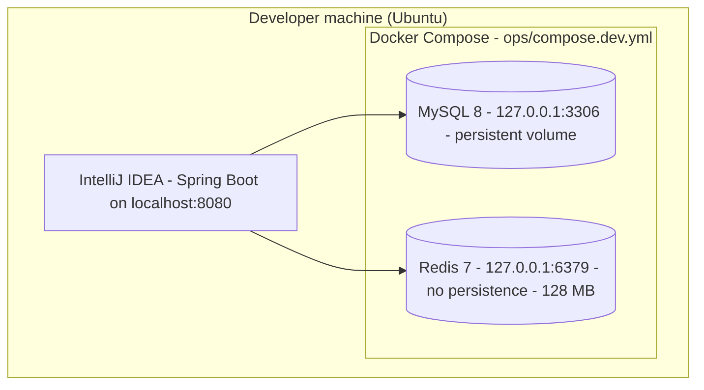
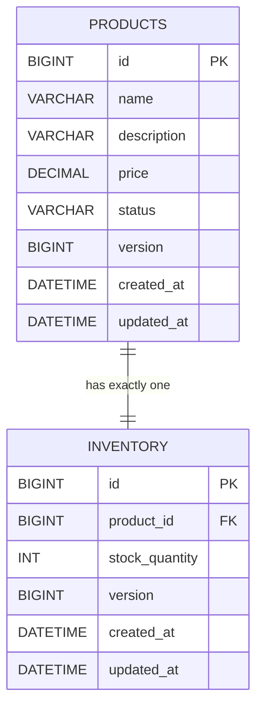

# PROJECT.md — Redis Engineering Lab: Complete Project Description

> **Document set:** `PROJECT.md` (this file: what & why) · [`IMPLEMENTATION.md`](IMPLEMENTATION.md) (how) · [`FLOW.md`](FLOW.md) (request flows) · [`ROADMAP.md`](ROADMAP.md) (stages) · [`API.md`](API.md) (API contract)
>
> **Decision status legend** (used in every document)
>
> | Tag | Meaning |
> |---|---|
> | **[Confirmed]** | Explicitly agreed in the design conversation. Treated as final. |
> | **[Resolved R-xx]** | The conversation was contradictory, incomplete, or technically wrong. A decision was made using engineering judgment. See [§17](#17-decision-register) and the separate `DECISION_GAP_REPORT.md`. |
> | **[Open O-xx]** | Cannot be safely decided yet. Marked **To Be Decided**. |

---

## 1. Project overview

**Redis Engineering Lab** is a small Java 21 / Spring Boot backend whose real purpose is to **learn Redis by solving realistic backend problems** (caching, invalidation, rate limiting, concurrency, messaging, reliability). It is *not* an e-commerce application.

The supporting application is a **Product & Inventory Management Service**: an admin manages products and stock, the public reads them. Every design choice in the project must answer: *"Which Redis concept does this teach?"* **[Confirmed]**

| Item | Value |
|---|---|
| Repository / project name | `redis-engineering-lab` **[Confirmed]** |
| Maven group / package | `com.redislab` **[Confirmed]** |
| Primary goal | Understand Redis from fundamentals to practical backend engineering through small, controlled experiments |
| Learning style | Progressive: one Redis concept per stage; understand → design → draw flow → implement → test → break it **[Confirmed]** |
| Phase 1 development setup | Spring Boot runs locally (IntelliJ, `localhost:8080`); MySQL 8 and Redis run in Docker Compose **[Confirmed]** |

## 2. Problems and learning objectives

### 2.1 Backend problems the project simulates

Imagine a store with 10,000 products and thousands of users during a sale.

| # | Problem | Redis concept it teaches | Phase |
|---|---|---|---|
| P1 | Every product view hits MySQL with the same query | Cache-aside, TTL | 1 |
| P2 | Admin changes a price, but users still see the old one | Cache invalidation | 1 |
| P3 | Paginated lists become wrong when one product changes | List caching, key scanning | 1 |
| P4 | A client sends 1,000 requests per minute | Token bucket, Lua, atomicity | 1 |
| P5 | Redis dies while users are browsing | Fail-open, timeouts, reconnection | 1 |
| P6 | A hot key expires and 100 requests hit MySQL at once | Cache stampede, distributed lock | 2 |
| P7 | Network retry doubles a stock increment | Idempotency keys | 2 |
| P8 | Other components must learn that stock changed | Pub/Sub | 2 |
| P9 | Subscriber was offline and missed the message | Streams, consumer groups | 3 |
| P10 | Several app instances share state | Shared Redis, multi-instance behavior | 3 |
| P11 | Redis restarts / runs out of memory | RDB, AOF, eviction, monitoring | 4 |
| P12 | Is caching really faster? Where is the bottleneck? | Load testing, measurement | 5 |

### 2.2 Completion measures **[Confirmed]**

By the end, the learner can: explain Redis architecture in their own words; choose the right Redis data structure; implement caching *without blindly relying on annotations*; explain invalidation strategies; implement distributed rate limiting; explain distributed locking **and its limits**; debug with `redis-cli`; explain when Redis is *not* useful.

## 3. Why Redis is the main focus

- Product, inventory and CRUD logic are deliberately **kept simple**. The conversation drifted into MySQL transactions and JPA locking and was explicitly corrected back to Redis **[Confirmed]**.
- MySQL is the **source of truth**; Redis is an **optional performance and coordination layer** that must never decide business correctness.
- Spring's cache annotations (`@Cacheable`…) are **not** used in Phase 1. We use `RedisTemplate`-style code so that every Redis command is visible and understood **[Confirmed]**. Annotation comparison is optional later (see [O-03](#173-open-decisions-to-be-decided)).

## 4. Why Product & Inventory Management as the supporting domain

| Reason | Explanation |
|---|---|
| Read-heavy vs write-heavy data | Product details change rarely (long TTL); stock changes often (short TTL). Gives two cache policies to compare. |
| Natural invalidation problems | A price update invalidates a product *and* every cached list page. |
| Natural concurrency | Many admins/clients change the same stock row. |
| Public vs admin split | Realistic read-heavy public traffic and controlled admin writes, without building login. |
| Small | Two tables, 13 business endpoints. Business logic never overshadows Redis. |

## 5. Scope and boundaries

### 5.1 Included features

| Area | Features | Phase |
|---|---|---|
| Product management | Create, update (full), activate, deactivate, public detail, public paginated list, admin detail, admin paginated list | 1 |
| Inventory management | Public read, admin read, set absolute, increment, decrement | 1 |
| Caching | Product detail, inventory, public product-list pages (cache-aside + invalidation) | 1 |
| API protection | Token-bucket rate limiting on public reads; static admin API key | 1 |
| Reliability | Redis timeouts, fail-open fallback, automatic reconnection | 1 |
| Operations | Actuator health, logs, Redis CLI inspection, Swagger UI | 1 |
| Learning endpoints | Temporary `/api/dev/redis/**` sandbox | 1 (dev only) |
| Coordination & messaging | Stampede lock, idempotency, Pub/Sub | 2 |
| Streams & multi-instance | Redis Streams, consumer groups, multiple app instances | 3 |
| Reliability & ops | RDB, AOF, eviction, memory, monitoring, recovery | 4 |
| Performance | Load tests, consistency experiments, bottleneck analysis | 5 |

### 5.2 Explicitly excluded **[Confirmed]**

Customer registration/authentication, JWT / Spring Security, shopping cart, orders and payments, product reviews, frontend application, microservices, **permanent product deletion** (no `DELETE` endpoint), partial product update (`PATCH` update), dynamic sorting, admin-list caching, response wrapper envelopes, Redis connection pooling, application-level Redis retries (Phase 1), full observability stack (Prometheus/Grafana — Phase 4).

> **Superseded early drafts [Resolved R-19]:** the very first plan listed `DELETE /api/products/{id}`, `PATCH /api/inventory/{id}/increment` and 6 "learning modules". These were replaced by later confirmed decisions (soft-delete via deactivate, `POST` increment/decrement under `/api/admin`, phased roadmap). Nothing in this document set uses the early drafts.

## 6. Technology stack

| Technology | Version | Purpose |
|---|---|---|
| Java | 21 | Language (records for DTOs) |
| Spring Boot | 3.x — latest 3.5.x patch at project creation, pinned in `pom.xml` ([O-10](#173-open-decisions-to-be-decided)) | Web framework |
| Maven | 3.9+ | Build and dependency management |
| MySQL | 8.0 | Primary database / source of truth |
| Redis | 7.2 (Docker image) | Cache, rate limiter, later locks/messaging |
| Spring Data Redis + Lettuce | Boot-managed | Redis client (thread-safe shared connection) |
| Spring Data JPA / Hibernate | Boot-managed | Persistence |
| Flyway (`flyway-core` + `flyway-mysql`) | Boot-managed | Versioned schema migrations; Hibernate only *validates* |
| Jakarta Bean Validation | Boot-managed | Request validation |
| Spring Boot Actuator | Boot-managed | Health endpoint |
| Springdoc OpenAPI + Swagger UI | 2.8.x | Interactive API docs (added in Stage 4) |
| Docker Compose | v2 | Runs MySQL and Redis |
| JUnit 5 + Mockito | Boot-managed | Unit tests |
| Testcontainers | Boot-managed | Real MySQL + Redis in integration tests |
| Postman | — | Saved API scenarios |
| k6 or JMeter | To Be Decided ([O-04](#173-open-decisions-to-be-decided)) | Load tests (Phase 5; simple concurrency tests earlier) |
| Redis CLI | — | Inspect keys, TTLs, memory |

## 7. High-level architecture

### 7.1 Logical architecture



### 7.2 Deployment (Phase 1) **[Confirmed]**



Ports are bound to `127.0.0.1` only **[Resolved R-32]** (Redis has no password in the lab, so it must not be reachable from the network).

### 7.3 Modular monolith **[Confirmed]**

One deployable application, split into feature packages with clear responsibilities:

| Module | Responsibility | Talks to |
|---|---|---|
| `product` | Product API, rules, persistence | MySQL, `cache` |
| `inventory` | Stock API, rules, persistence | MySQL, `cache` |
| `cache` | Redis key naming, JSON codec, cache services, fail-open wrapper | Redis |
| `ratelimit` | Token bucket, client-IP resolution, interceptor | Redis |
| `config` | Redis, web, OpenAPI, typed properties | — |
| `common` | Error model, exceptions, global handler, admin-key interceptor | — |
| `redis` | **Dev-only** Redis sandbox (Stage 2) | Redis |

Business services never contain raw Redis commands; they call the dedicated cache services **[Confirmed]**. Package-level detail is in [IMPLEMENTATION.md §2](IMPLEMENTATION.md#2-package-structure).

## 8. MySQL and Redis responsibilities

| Data / duty | MySQL | Redis |
|---|---|---|
| Product records | ✅ source of truth | cached copy (15 min) |
| Inventory quantity | ✅ source of truth | cached copy (30 s) |
| Public product-list pages | computed from products | cached pages (15 min) |
| Admin product detail / list, admin inventory read | ✅ always | ❌ never cached |
| Rate-limit buckets | ❌ | ✅ (Hash + Lua) |
| Locks, idempotency keys, Pub/Sub, Streams | ❌ | ✅ (Phases 2–3) |
| Concurrency control for stock | ✅ atomic SQL + optimistic locking | later *experiment* only |

**Rules:** Redis is never a source of truth in Phase 1. A Redis failure must never turn a successful MySQL write into a failed API response. After Redis loses data, everything must still work from MySQL.

## 9. Product and inventory domain rules

### 9.1 Data model **[Confirmed]** (SQL in [IMPLEMENTATION.md §6](IMPLEMENTATION.md#6-flyway-migrations))



### 9.2 Product rules

| Rule | Behavior |
|---|---|
| Creation | Admin provides `name`, `description?`, `price`. Status is always `ACTIVE`. Product + inventory(0) are inserted in **one MySQL transaction**. |
| Validation | Name required, 3–100 chars, not unique. Description optional, ≤ 500. Price > 0 and ≤ 99,999,999.99 with ≤ 2 decimals ([R-16](#172-resolved-decisions)). |
| Update | **Full update** via `PUT`; fields `name`, `description`, `price`, `version`. **Status is not editable through PUT** ([R-04](#172-resolved-decisions)). |
| Optimistic locking | JPA `@Version`. Client sends `version`; a stale version → `409 CONCURRENT_MODIFICATION`. |
| No-change update | If submitted values equal stored values (and version matches): return success, **no DB write, no cache invalidation**. |
| Activate / deactivate | `PATCH …/activate`, `PATCH …/deactivate`. **Idempotent**: repeating returns success with no write and no invalidation. |
| Deactivated product | Hidden from public APIs (`404`); still manageable by admin; product and inventory rows and stock quantity are preserved. |
| Deletion | No permanent delete. |
| Listing | Public: ACTIVE only. Admin: ACTIVE + INACTIVE. Sorted `created_at DESC, id DESC` (id is a tie-breaker, [R-17](#172-resolved-decisions)). Default page 0, size 20, max 50. |

### 9.3 Inventory rules

| Rule | Behavior |
|---|---|
| One-to-one | Exactly one inventory row per product (unique `product_id`), created with the product at quantity 0. |
| Negative stock | Never allowed (DB `CHECK` + conditional SQL). Zero is allowed. |
| Set | `stockQuantity ≥ 0`; requires `version`; **optimistic locking**; stale → `409 CONCURRENT_MODIFICATION`. |
| Increment | `quantity > 0`; **atomic SQL**; also bumps `version` ([R-06](#172-resolved-decisions)). |
| Decrement | `quantity > 0`; **conditional atomic SQL** (`… AND stock_quantity >= :q`); insufficient → `409 INSUFFICIENT_STOCK`. Also bumps `version`. |
| Upper bound | Stock and single operation limited to 1,000,000,000 so the `INT` column cannot overflow ([R-16](#172-resolved-decisions)); exceeding → `409 STOCK_LIMIT_EXCEEDED` (increment) or `400` (validation). |
| Admin on inactive product | Allowed. Public read of an inactive product's inventory → `404`. |
| Public response | `{productId, stockQuantity}` only. Status (`IN_STOCK`/`OUT_OF_STOCK`) is *derived by clients*, never stored or returned. |
| Concurrency baseline | MySQL atomic updates. Redis locking is a **later experiment** (Phase 2) and must be compared against this baseline, not used "because Redis can". |

## 10. Redis architecture and key design

### 10.1 Conventions **[Confirmed]**

- Logical database **0** for everything; separation by key prefix, not by DB number.
- Pattern: `<project>:<environment>:<module>:<identifier>` with **colon** delimiter.
- Project = `redis-lab`, environment = `dev` (configurable: `test`, `prod`). **No version segment** in keys ([R-18](#172-resolved-decisions): the conversation recommended then confirmed different options; the confirmed one — environment-aware, unversioned — wins; versioning is a Phase 5 experiment).

### 10.2 Key inventory

| Purpose | Key pattern | Type | TTL | Phase |
|---|---|---|---|---|
| Product detail cache | `redis-lab:dev:product:{id}` | String (JSON) | 15 min | 1 |
| Inventory cache | `redis-lab:dev:inventory:{productId}` | String (JSON) | 30 s | 1 |
| Product-list page cache | `redis-lab:dev:products:page:{page}:size:{size}` | String (JSON) | 15 min | 1 |
| Rate-limit bucket | `redis-lab:dev:rate-limit:{clientIp}` | **Hash** (`tokens`, `last_refill_time`) | seconds-to-full + 60 s | 1 |
| Dev sandbox keys | `redis-lab:dev:sandbox:{key}` | String | caller-defined | 1 (dev only) |
| Cache-rebuild lock | `redis-lab:dev:lock:product:{id}` | String (random token) | short lease — [O-06](#173-open-decisions-to-be-decided) | 2 |
| Idempotency record | `redis-lab:dev:idempotency:{key}` | String/Hash | To Be Decided ([O-02](#173-open-decisions-to-be-decided)) | 2 |
| Inventory event channel | `redis-lab:dev:events:inventory` | Pub/Sub channel | none | 2 |
| Inventory event stream | `redis-lab:dev:stream:inventory` | Stream | retention — [O-01](#173-open-decisions-to-be-decided) | 3 |

Admin responses are never cached, so there are no admin keys. IPv6 colons in `{clientIp}` are replaced with `_` so they do not break the colon hierarchy ([R-20](#172-resolved-decisions)).

### 10.3 Cached value formats **[Confirmed]** — plain readable JSON

```json
// redis-lab:dev:product:101  (public product DTO — no version)
{ "id": 101, "name": "Wireless Mouse", "description": "Bluetooth wireless mouse", "price": 799.00, "status": "ACTIVE" }

// redis-lab:dev:inventory:101  (public inventory DTO — no version)
{ "productId": 101, "stockQuantity": 50 }
```

The page cache stores the complete `PageResponse` (`content`, `page`, `size`, `totalElements`, `totalPages`, `last`). Values contain **no Java class names** (`@class`) — see [R-09](#172-resolved-decisions) and [IMPLEMENTATION.md §13](IMPLEMENTATION.md#13-redistemplate-and-json-serialization).

### 10.4 Redis server configuration (Phase 1) **[Confirmed]**

| Setting | Value |
|---|---|
| `maxmemory` | 128 MB (container limit slightly higher: 192 MB) |
| `maxmemory-policy` | `noeviction` — writes fail with OOM when full; deletes still work |
| Persistence | none (`--save ""`, `--appendonly no`) — a restart empties Redis |
| Client | Lettuce, one shared connection, **no pool** |
| Connect timeout / command timeout | 2 s / 1 s |
| Reconnection | automatic (Lettuce) |
| App-level retries | none |

## 11. Cache strategy and TTL decisions

**Pattern: cache-aside with invalidate-on-write [Confirmed].**

1. Read: check Redis → hit: return. Miss: read MySQL → store in Redis with TTL → return.
2. Write: update MySQL → **after commit** delete the affected Redis keys ([R-07](#172-resolved-decisions) explains why "after commit" needs deliberate coding).

| Cache | TTL | Why |
|---|---|---|
| Product detail | 15 min | Changes rarely |
| Public product list | 15 min | Same freshness class as products; invalidated on any product change |
| Inventory | 30 s | Changes often; short TTL bounds staleness |

Rules **[Confirmed]**:

- **Not-found and inactive results are never cached** (no negative caching).
- Lazy cache rebuilding after a Redis outage — **no warm-up**.
- Admin reads always go to MySQL.
- No stampede protection in Phase 1 (we reproduce the problem first; Phase 2 solves it).

### Invalidation matrix (summary — full version with flows in [FLOW.md §12](FLOW.md#12-cache-invalidation))

| MySQL change | Delete product key | Delete inventory key | Delete all list pages |
|---|---|---|---|
| Create product | – | – | ✅ |
| Update product (changed) | ✅ | – | ✅ |
| Activate / deactivate (changed) | ✅ | ✅ | ✅ |
| Set / increment / decrement inventory | – | ✅ | – |
| Any no-op (unchanged update, repeated activate) | – | – | – |

List pages are found with a controlled **`SCAN`** (never `KEYS`) **[Resolved R-14]** (the conversation allowed "SCAN or a maintained set of keys"; SCAN is stateless and has no second key to keep consistent).

### Known cache-consistency limits (accepted in Phase 1) **[Resolved R-24]**

1. **Stale-write race:** a reader loads old data from MySQL, an admin updates + invalidates, then the reader writes the *old* value to Redis. Worst case: stale data until TTL (30 s inventory, 15 min product). Reproduced and studied in Phase 5.
2. **Failed invalidation:** if Redis is down/slow at invalidation, the old value survives until TTL. We log and return success.
3. A deactivated product could, in the race above, stay publicly visible until its 15-minute TTL.

## 12. Rate-limiting strategy **[Confirmed]**

| Setting | Value |
|---|---|
| Algorithm | Token bucket, implemented in an **atomic Lua script** |
| Capacity / refill | 10 tokens / 1 token per second (burst 10, sustained 1 req/s) |
| Client identity | Client IP |
| Bucket scope | **One shared bucket per IP** across all rate-limited endpoints |
| Covered endpoints | All public read APIs: `GET /api/products/{id}`, `GET /api/inventory/{productId}`, and `GET /api/products` ([R-02](#172-resolved-decisions): the list was added later and was missing from the enumerated list; the intent was "all public reads") |
| Not covered | Admin APIs, `/actuator/**`, Swagger, dev sandbox |
| Storage | Redis Hash `{tokens, last_refill_time}` |
| Key expiry | **60 s after the bucket becomes full** (`EXPIRE = secondsUntilFull + 60`) |
| Rejection | `429` + standard error JSON + `Retry-After` |
| Headers on every rate-limited response | `X-RateLimit-Limit`, `X-RateLimit-Remaining`, `X-RateLimit-Reset` |
| Redis failure | **Fail open** — allow the request, log it |

Time is taken from **Redis `TIME` inside the script**, not from the application clock, so several app instances cannot disagree ([R-11](#172-resolved-decisions)). Client IP comes from the socket address; `X-Forwarded-For` is trusted only when explicitly enabled behind a known proxy ([R-20](#172-resolved-decisions)). Algorithm walk-through: [IMPLEMENTATION.md §20](IMPLEMENTATION.md#20-token-bucket-rate-limiter), flows: [FLOW.md §13–16](FLOW.md#13-redis-token-bucket).

## 13. Redis failure-handling strategy **[Confirmed]**

Redis is an optimization; the application must stay up.

| Situation | Behavior |
|---|---|
| Redis down/timeout on cache **read** | Treat as miss → read MySQL → return (skip cache write) |
| Redis fails on cache **write** | Log; return MySQL result |
| Redis fails on **invalidation** | Log; still return success (MySQL committed); stale data bounded by TTL |
| Redis fails in **rate limiter** | Fail open: allow request, log, no rate-limit headers |
| Redis out of memory (`noeviction`) | Writes (cache fill, rate-limit script) fail → same as "down"; `DEL`/`UNLINK` still work |
| Redis returns unreadable/corrupt JSON | Treat as miss, delete the key, log |
| Redis recovers | Lettuce reconnects automatically; cache rebuilds lazily; no restart needed |
| Dev sandbox endpoints | No fallback — return `503 REDIS_UNAVAILABLE` (their purpose is to *show* Redis) |

Mechanisms: 2 s connect timeout, 1 s command timeout, **commands rejected immediately while disconnected** (so an outage does not add 1 s to every request — [R-10](#172-resolved-decisions)), no app retries. Details: [IMPLEMENTATION.md §19](IMPLEMENTATION.md#19-redis-failure-fallback).

## 14. Security boundaries

| Boundary | Decision |
|---|---|
| Public reads | No authentication; rate limited |
| Admin APIs | Static key in header `X-Admin-Key`, validated against an environment-supplied secret; missing/wrong → `401 INVALID_ADMIN_KEY` **[Confirmed]** |
| Secret handling | Not in Git; `ADMIN_API_KEY` env var; the app **refuses to start** if it is empty ([R-26](#172-resolved-decisions)); constant-time comparison |
| Dev sandbox | Active only in the `dev` profile, requires the admin key, works only inside `redis-lab:dev:sandbox:*` ([R-13](#172-resolved-decisions)) |
| Error responses | Generic `500`; stack traces/SQL never returned |
| Network | MySQL/Redis bound to loopback |
| Known gap | Admin-key brute force is not rate limited ([O-08](#173-open-decisions-to-be-decided)); this is a lab simulation, not production auth |

## 15. Observability (Phase 1) **[Confirmed]**

Actuator `GET /actuator/health` (basic UP/DOWN, no connection details), application logs (cache hit/miss/failure, fallbacks, rate-limit rejections), Redis CLI (`KEYS`-free inspection with `SCAN`, `TTL`, `INFO memory`). Redis is treated as a **non-critical** dependency in health ([R-12](#172-resolved-decisions)). Prometheus/Grafana/Micrometer/Redis Exporter arrive in Phase 4.

## 16. Phase-wise Redis learning objectives

| Phase | Theme | Redis objectives |
|---|---|---|
| **1** | Fundamentals + core backend | CLI basics; strings/TTL; Spring Data Redis + Lettuce; JSON serialization; cache-aside; TTL; invalidation; list caching with `SCAN`; Hash; **Lua** + atomicity; token bucket; timeouts and fail-open; reproduce a stampede (no fix) |
| **2** | Coordination & messaging | `SET NX PX` locks + safe release; stampede protection; idempotency keys; Pub/Sub; lock failure modes (expiry, ownership); optional retry / Spring Cache comparisons |
| **3** | Streams & multiple instances | Run 2+ app instances; shared cache/limits; `XADD`, `XREADGROUP`, `XACK`, pending entries, `XAUTOCLAIM`; Pub/Sub vs Streams |
| **4** | Reliability & operations | RDB, AOF, persistence comparison, eviction policies, memory analysis, monitoring stack, failure recovery |
| **5** | Advanced performance & consistency | Multi-instance tests, consistency races and fixes (versioned keys, delayed delete), load testing, measurement, bottleneck analysis |

Stage-by-stage plan: [ROADMAP.md](ROADMAP.md).

## 17. Decision register

### 17.1 Confirmed decisions (condensed)

| Area | Decision |
|---|---|
| Scope | Focused Redis lab (Option A) |
| Access | Public reads + admin writes; static admin key |
| Data | Separate `products` and `inventory` tables; separate APIs |
| Inventory | Set + increment + decrement; atomic SQL; optimistic lock on set |
| Product concurrency | `@Version` in request body |
| Caching | Cache-aside, invalidate (not update) after commit; TTL 15 min / 30 s; list pages cached; no negative caching |
| Redis ops | Fail-open; lazy rebuild; no retries; no pool; 2 s / 1 s timeouts; automatic reconnect; DB 0; noeviction; 128 MB; no persistence in Phase 1 |
| Rate limiting | Token bucket 10 / 1 per s; per IP; shared bucket; public reads; 429 JSON + headers; fail open |
| API shape | Direct DTOs (no wrapper); pagination metadata DTO; standard error JSON; all field errors together; generic 500 |
| Tooling | Flyway; Springdoc; Testcontainers; JUnit 5; modular monolith; Docker Compose for infra |
| Phasing | No stampede protection / Pub/Sub / Streams / idempotency / persistence experiments in Phase 1 |
| Build order | Redis connection first, minimum APIs after (Option B) |

### 17.2 Resolved decisions

Short list (rationale in `DECISION_GAP_REPORT.md`; relevant documents carry inline notes).

| ID | Resolution |
|---|---|
| R-01 | Roadmap phases follow the project brief: token bucket + Lua is **Phase 1 (Stage 8)**; Phase 2 = stampede/idempotency/Pub/Sub/locking; Phase 3 = Streams/multi-instance. The "revised phases" table in the chat placed rate limiting in Phase 2 — rejected. |
| R-02 | Public list is also rate limited. |
| R-03 | `INVENTORY_NOT_FOUND` for inventory endpoints; `PRODUCT_NOT_FOUND` for product endpoints. |
| R-04 | `PUT` product has no `status`; status only via activate/deactivate. |
| R-05 | Activate/deactivate responses and admin inventory write responses include `version`. |
| R-06 | Increment/decrement bump the inventory `version`. |
| R-07 | Invalidate **after commit** using `TransactionTemplate` (not inside `@Transactional`). |
| R-08 | Admin-key and rate-limit checks are Spring MVC **interceptors** (so the global handler can format their errors). |
| R-09 | Cache values written as explicit JSON strings via `StringRedisTemplate` + `ObjectMapper`; Lua uses `StringRedisTemplate`. No Jackson default typing. |
| R-10 | Lettuce `REJECT_COMMANDS` while disconnected. |
| R-11 | Lua uses Redis `TIME`; key TTL = seconds-to-full + 60. |
| R-12 | Health: Redis does not make overall health DOWN. |
| R-13 | Dev sandbox hardening. |
| R-14 | `SCAN` for list invalidation. |
| R-15 | Do not cache empty out-of-range list pages (cache-pollution guard). |
| R-16 | Input limits (price, stock, quantity). |
| R-17 | Update semantics: version check first, `BigDecimal.compareTo`, tie-break sort, no-op for inventory set. |
| R-18 | No key versioning. |
| R-19 | Early-draft endpoints superseded. |
| R-20 | Client IP resolution and IPv6 key sanitizing. |
| R-21 | Package/class naming reconciled (`config/RedisConfig`, `cache/...`, dev sandbox in `redis`). |
| R-22 | Spring Cache annotations moved to an optional Phase 2 comparison ([O-03](#173-open-decisions-to-be-decided)). |
| R-23 | Flyway split V1 products / V2 inventory / V3 indexes (the conversation showed both a single script and three files). |
| R-24 | Stale-write race documented as known limitation. |
| R-25 | Extra framework error codes added. |
| R-26 | Admin key fail-fast + constant-time compare. |
| R-27 | Corrupt cache entries = miss + delete. |
| R-28 | `flyway-mysql` dependency; UTC time zone; `open-in-view=false`. |
| R-29 | Header semantics: `Retry-After` integer seconds; `X-RateLimit-Reset` Unix epoch seconds. |
| R-30 | Multi-instance Pub/Sub testing is Phase 3. |
| R-31 | Phase 1 reproduces a stampede with a concurrency test (no fix). |
| R-32 | Loopback-only port binding; no Redis password in the lab. |

### 17.3 Open decisions (To Be Decided)

| ID | Topic | Why it matters |
|---|---|---|
| O-01 | Stream retention (`MAXLEN`/trim policy) | Memory growth under `noeviction` |
| O-02 | Idempotency-key TTL and storage durability | Redis can lose keys; duplicates possible after loss |
| O-03 | When/whether to compare Spring Cache annotations | Original plan wanted it; placed as optional Stage 2.5 |
| O-04 | k6 vs JMeter | Only affects Phase 5 scripts |
| O-05 | Page-cache versioning experiment | Alternative to SCAN invalidation |
| O-06 | Lock lease, wait time, polling interval | Needs measurement in Phase 2 |
| O-07 | Pub/Sub publish timing and event schema evolution | Before vs after commit/invalidation |
| O-08 | Rate limiting failed admin-key attempts | Brute-force protection |
| O-09 | Optional `X-Cache: HIT/MISS` debug header | Not agreed; would change contract |
| O-10 | Exact patch versions (Boot, Redis/MySQL images) | Pin at Stage 1 |
| O-11 | Retry policy parameters for Redis commands | Phase 2/4 experiment |
| O-12 | Redis HA / failover scope (Sentinel/Cluster) | Mentioned in Phase 5 plan without detail |
| O-13 | Monitoring stack scope | Phase 4 |
| O-14 | API-key-based rate limiting | "Later" experiment |

## 18. Final expected outcome

- A running Spring Boot service with **13 business endpoints** + health, documented in Swagger UI and `API.md`.
- Product, inventory and list caching with measured hit/miss behavior and correct invalidation.
- A Lua-based token bucket verified under concurrency and across instances.
- Demonstrated, tested behavior when Redis is slow, down, out of memory, or restarted.
- Experiments proving *why* stampede protection, locks, idempotency, Pub/Sub and Streams exist, including their limits.
- A learner who can reason about Redis trade-offs, not just copy annotations.
