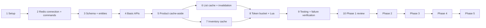

# ROADMAP.md — Stage-by-Stage Development Roadmap

> Part of the documentation set: [`PROJECT.md`](PROJECT.md) · [`IMPLEMENTATION.md`](IMPLEMENTATION.md) · [`FLOW.md`](FLOW.md) · **`ROADMAP.md`** · [`API.md`](API.md)
> Decision tags: **[Confirmed]**, **[Resolved R-xx]**, **[Open O-xx]** ([register](PROJECT.md#17-decision-register)).

## 0. How to use this roadmap

**Working cycle for every stage [Confirmed]:** understand the concept → identify the problem → draw the flow → implement one feature → test with Postman **and** Redis CLI → break it (failure/concurrency) → write down what you learned.

**Rule:** do not start a stage until the previous stage's *completion criteria* are all true. Design questions already settled are not reopened unless a genuine conflict appears.

**Suggested pace:** the original plan suggested ~2–3 weeks for the core lab; Phase 1 fits that range. Later phases are open-ended. Understanding matters more than speed.

### Overview and dependencies

| Phase | Theme | Stages |
|---|---|---|
| 1 | Redis fundamentals and core backend | 1–10 |
| 2 | Coordination and messaging | 2.1–2.5 |
| 3 | Streams and multiple instances | 3.1–3.5 |
| 4 | Reliability and operations | 4.1–4.7 |
| 5 | Advanced performance and consistency | 5.1–5.5 |

Phase placement rationale ([R-01]): the project brief puts token bucket/Lua in Phase 1 and locks/idempotency/Pub/Sub in Phase 2; a "revised phases" table in the chat contradicted this and was not followed. Multi-instance Pub/Sub testing belongs to Phase 3 ([R-30]).

---

# PHASE 1 — Redis fundamentals and core backend

**Phase goal:** a working Product & Inventory API where Redis speeds up reads, stays consistent via invalidation, protects public reads with a token bucket, and **never makes the app fail** when Redis does.

---

## Stage 1 — Application and infrastructure setup

| | |
|---|---|
| **Purpose** | A running Spring Boot app connected to MySQL, with Redis and MySQL in Docker. |
| **Why required** | Everything later depends on a reproducible environment and correct configuration. |
| **Concepts** | Docker Compose, Redis container flags (`maxmemory`, `noeviction`, no persistence), Spring profiles, externalized secrets, Flyway wiring. |
| **Implement** | Project from Spring Initializr (deps in [IMPLEMENTATION §1.1](IMPLEMENTATION.md#11-maven-dependencies), without Springdoc); `ops/compose.dev.yml`; `.env.example`, `.gitignore` (`.env`); `application.yml`/`application-dev.yml`; `AppProperties`; Actuator health; empty `db/migration` folder; `README.md` with run steps. |
| **Files** | `pom.xml`, `ops/compose.dev.yml`, `.env.example`, `src/main/resources/application*.yml`, `RedisEngineeringLabApplication`, `config/AppProperties`. |
| **APIs** | `GET /actuator/health` only. |
| **How to test** | `docker compose … up -d` → both healthy; `docker exec redislab-redis redis-cli CONFIG GET maxmemory` (= 134217728), `CONFIG GET maxmemory-policy` (= noeviction), `CONFIG GET save` (empty); start app; `curl localhost:8080/actuator/health`; start without `ADMIN_API_KEY` → app **fails to start** ([R-26]). |
| **Expected output** | Health shows `db` UP and `redis` UP; Redis restart empties it. |
| **Completion criteria** | App boots; MySQL and Redis reachable; secrets only from env/`.env`; Redis limits verified; versions pinned ([O-10]). |
| **End goal** | A clean, reproducible foundation. |

## Stage 2 — Redis connection and basic commands

| | |
|---|---|
| **Purpose** | Talk to Redis from Java and see exactly what is stored. |
| **Why required** | Redis is the learning objective; understand commands and serialization before building features on them. |
| **Concepts** | Lettuce, shared connection, timeouts, `REJECT_COMMANDS`, `SET/GET/DEL/EXISTS/EXPIRE/TTL`, keys & expiry, String type, JDK vs JSON serialization, `redis-cli`, `SCAN` vs `KEYS`. |
| **Implement** | `RedisConfig` (Lettuce options) ; `RedisKeyBuilder` (sandbox key + prefix); `RedisSandboxService`/`Controller` (`@Profile("dev")`); **minimum common web infra the sandbox needs**: `ErrorResponse`, `GlobalExceptionHandler` skeleton, `AdminKeyInterceptor`, `WebConfig`; custom `RedisHealthIndicator` ([R-12]). Experiment: write a key with a default JDK-serialized template and compare with the String/JSON design. |
| **Files** | `config/RedisConfig`, `config/WebConfig`, `cache/key/RedisKeyBuilder`, `redis/*`, `common/exception/*`, `common/response/ErrorResponse`, `common/security/AdminKeyInterceptor`. |
| **APIs** | Dev endpoints D1–D6 ([API §6](API.md#6-development-only-redis-learning-endpoints)); health. |
| **How to test** | Postman: set `demo` with TTL 60 → `redis-cli GET redis-lab:dev:sandbox:demo` and `TTL` → compare with API `ttl`; wait for expiry → `404 REDIS_KEY_NOT_FOUND`; call without key → `401`; **stop Redis** → sandbox returns `503 REDIS_UNAVAILABLE`, `/actuator/health` stays `UP`; start Redis → works again with **no app restart**; time a request while Redis is stopped (must be fast, [R-10]). |
| **Expected output** | Readable keys in CLI; correct TTL countdown; clean 401/503 JSON errors. |
| **Completion criteria** | All six sandbox commands match the CLI; automatic reconnection proven; admin-key and error format work; health behaves per R-12; you can explain why default serialization looked like binary. |
| **End goal** | Confidence that Java ⇄ Redis works and you can inspect it. |

## Stage 3 — Minimum product and inventory foundation

| | |
|---|---|
| **Purpose** | Persistent MySQL model for products and inventory. |
| **Why required** | Cache-aside needs a source of truth; the minimum model keeps MySQL simple (scope correction [Confirmed]). |
| **Concepts** | Flyway versioned migrations, `ddl-auto=validate`, optimistic locking (`@Version`), one-to-one with unique FK, atomic SQL updates, DECIMAL for money, UTC timestamps. |
| **Implement** | `V1`, `V2`, `V3` migrations; `Product`, `ProductStatus`, `Inventory` entities; repositories incl. atomic `increment`/`decrement` and `findPublicByProductId`; domain exceptions. |
| **Files** | `db/migration/V1…V3`, `product/entity/*`, `inventory/entity/*`, `*/repository/*`, `common/exception/*`. |
| **APIs** | none yet. |
| **How to test** | Repository integration tests with Testcontainers MySQL: inserts respect `CHECK` constraints (negative stock/price rejected by DB); duplicate `product_id` rejected; Hibernate `validate` passes; decrement below zero updates 0 rows; version increments. Seed ~10,000 products with a dev-only script for later performance observations. |
| **Expected output** | Flyway applies V1–V3; `flyway_schema_history` shows 3 rows. |
| **Completion criteria** | Schema matches [IMPLEMENTATION §6](IMPLEMENTATION.md#6-flyway-migrations); repository tests green; atomic SQL verified. |
| **End goal** | A trustworthy source of truth. |

## Stage 4 — Basic API implementation (MySQL only)

| | |
|---|---|
| **Purpose** | Complete all 13 business endpoints **without Redis**. |
| **Why required** | Establish correct behavior and a baseline (latency, SQL count) before caching, so Redis's effect can be measured. |
| **Concepts** | DTOs/records, Bean Validation, `TransactionTemplate`, global error contract, idempotent PATCH, optimistic-lock conflicts, pagination, OpenAPI. |
| **Implement** | DTOs; `ProductService`, `InventoryService` (all rules from [API.md](API.md)); public and admin controllers; `PageRequestValidator`, `PageResponse`; full `GlobalExceptionHandler`; Springdoc + `OpenApiConfig`; Postman collection. |
| **Files** | `product/**`, `inventory/**`, `common/**`, `config/OpenApiConfig`. |
| **APIs** | Endpoints 1–13 ([API §1.1](API.md#11-endpoint-summary)). Rate limiting not yet. |
| **How to test** | Postman collection from [API §8](API.md#8-quick-scenario-checklist-for-postman); unit tests for services (Mockito); two parallel `PUT`s with the same version; 100 parallel decrements (final stock 0, never negative); every error code at least once; deactivate → public 404, admin 200. |
| **Expected output** | Every response matches API.md; all errors use the standard JSON; Swagger UI usable with the admin key. |
| **Completion criteria** | All endpoints behave per contract; no Redis calls in business code; baseline timings recorded. |
| **End goal** | A correct, Redis-free backend to accelerate. |

## Stage 5 — Product detail cache-aside

| | |
|---|---|
| **Purpose** | First real cache: `GET /api/products/{id}`. |
| **Why required** | Core Redis lesson: cache-aside, TTL, invalidation, fail-open. |
| **Concepts** | Hit/miss, TTL 15 min, JSON values, invalidate-after-commit, negative-result policy (not cached), fail-open fallback, lazy rebuild. |
| **Implement** | `CacheJsonCodec`, `RedisFailSafe`, `ProductCacheService`; integrate into `ProductService` read path; invalidation in update/activate/deactivate (product key only for now); structured cache logs. |
| **Files** | `cache/support/*`, `cache/service/ProductCacheService`, `product/service/ProductService`. |
| **APIs** | `GET /api/products/{id}`; admin product writes (invalidation side effects). |
| **How to test** | (1) GET twice: logs `CACHE_MISS` then `CACHE_HIT`; SQL log shows one query; `redis-cli GET` shows JSON, `TTL` ≈ 900. (2) PUT price → key gone → next GET shows new price. (3) Unchanged PUT → key **stays**. (4) Deactivate → 404 and key gone. (5) GET missing id → 404, **no** key. (6) Stop Redis → still `200`; start Redis → refills. (7) Plant bad JSON with CLI → treated as miss, key deleted ([R-27]). |
| **Expected output** | MySQL called only on misses; correctness preserved after updates; zero errors during Redis outage. |
| **Completion criteria** | All seven checks pass; invalidation happens only after commit and only on real changes. |
| **End goal** | You can explain and demonstrate cache-aside, TTL and invalidation. |

## Stage 6 — Product-list caching and invalidation

| | |
|---|---|
| **Purpose** | Cache paginated public lists and invalidate them correctly. |
| **Why required** | List caching is the hard invalidation case: one change affects many keys. |
| **Concepts** | Per-page keys, `SCAN` vs `KEYS`, batch `UNLINK`, cursor handling, cache-pollution guard ([R-15]), invalidation matrix. |
| **Implement** | `ProductListCacheService` (`get/put/evictAll`); hook `evictAll()` into create, update (changed), activate/deactivate (changed). |
| **Files** | `cache/service/ProductListCacheService`, updates to `ProductService`. |
| **APIs** | `GET /api/products`; admin writes. |
| **How to test** | Cache pages 0–2 with different sizes → `SCAN` shows keys; create product → all gone; page 0 now contains the new product; request page 999 → `200` empty and **not cached**; `size=51` → 400; admin list always shows inactive items and never creates keys; Redis down → lists still served from MySQL. |
| **Expected output** | No stale page after any product change; no `KEYS` usage anywhere (grep). |
| **Completion criteria** | Matrix rows for product operations verified by tests. |
| **End goal** | Understand why list invalidation is hard and how a controlled scan solves it. |

## Stage 7 — Inventory caching and invalidation

| | |
|---|---|
| **Purpose** | Cache stock reads with a short TTL. |
| **Why required** | Contrasts a rarely changing cache (product) with a hot one (inventory, 30 s). |
| **Concepts** | Short TTL, bounded staleness, cache + status check, separate invalidation, versions not cached (public DTO). |
| **Implement** | `InventoryCacheService`; public read path; invalidation after set/increment/decrement; invalidate inventory in activate/deactivate. |
| **Files** | `cache/service/InventoryCacheService`, `inventory/service/InventoryService`, `ProductService` (status hook). |
| **APIs** | `GET /api/inventory/{productId}`; admin inventory writes. |
| **How to test** | GET → miss then hit, `TTL ≤ 30`; increment → key deleted → fresh value; wait 31 s → key expired; deactivate → `404` and key gone; reactivate → value back after one miss; admin GET never touches Redis; Redis stopped → `200` from MySQL. Observe a deliberate stale read by deleting nothing and changing MySQL directly, then watch it correct within 30 s. |
| **Expected output** | Fresh data after admin writes; staleness never beyond 30 s. |
| **Completion criteria** | Inventory rows of the matrix verified. |
| **End goal** | Choose TTLs by data volatility and reason about staleness. |

## Stage 8 — Redis token bucket and Lua

| | |
|---|---|
| **Purpose** | Protect public reads with an atomic per-IP token bucket. |
| **Why required** | Teaches atomicity, Hash, Lua, shared state across instances. |
| **Concepts** | Token bucket vs fixed/sliding window, race conditions, `EVALSHA`, Redis `TIME`, Hash fields, key expiry strategy, `429`/`Retry-After`, fail-open, IP resolution and spoofing. |
| **Implement** | `token_bucket.lua`; `TokenBucketRateLimiter`; `RateLimitResult`; `RateLimitProperties`; `ClientIpResolver`; `RateLimitInterceptor` for public GETs ([R-02]); `RateLimitExceededException` + handler headers. |
| **Files** | `ratelimit/*`, `resources/redis/token_bucket.lua`, `common/util/ClientIpResolver`, `WebConfig`. |
| **APIs** | All public reads gain rate-limit headers; `429` possible. |
| **How to test** | Postman runner/`curl` loop: 10 × 200 (`Remaining` 9→0), 11th = 429 with `Retry-After`; mixed product+inventory+list calls share one bucket; `redis-cli HGETALL redis-lab:dev:rate-limit:127.0.0.1` and `TTL`; wait for refill; stop Redis → requests pass, no headers, `RATE_LIMIT_REDIS_FAILURE` logged; fake `X-Forwarded-For` with trust disabled → ignored; script test with 50 parallel threads. |
| **Expected output** | Exactly the configured burst/sustained rate; consistent headers. |
| **Completion criteria** | Concurrency test shows no over-allowance beyond refill; key TTL ≈ secondsToFull + 60; admin/actuator/dev unaffected. |
| **End goal** | Implement and explain an atomic, distributed-safe rate limiter. |

## Stage 9 — Testing and failure verification

| | |
|---|---|
| **Purpose** | Prove behavior with automated tests and deliberate failures. |
| **Why required** | Caching bugs are subtle; failure behavior is a core requirement. |
| **Concepts** | Testcontainers, `@ServiceConnection`, concurrency tests, Awaitility, failure injection, SQL-count assertions. |
| **Implement** | `TestcontainersConfig`; the full scenario table in [IMPLEMENTATION §21.2](IMPLEMENTATION.md#212-required-scenarios); stampede **reproduction** test (documents the Phase 2 problem, [R-31]); manual failure drills: Redis stop/start, Redis OOM (fill 128 MB via dev tooling, observe `OOM command not allowed`, check cache writes fail but deletes work and the limiter fails open), Redis restart data loss. |
| **Files** | `src/test/**`, `TestcontainersConfig`. |
| **APIs** | All. |
| **How to test** | `mvn verify` with Docker running; manual drills recorded in `docs/experiments.md`. |
| **Expected output** | Green suite; written observations for every drill. |
| **Completion criteria** | Every scenario in §21.2 automated or manually verified; no request returns 5xx because of Redis; stampede count recorded. |
| **End goal** | Evidence — not belief — that the Phase 1 design works. |

## Stage 10 — Phase 1 review and documentation

| | |
|---|---|
| **Purpose** | Consolidate, clean up, document. |
| **Why required** | Prevents Phase 2 from building on unverified assumptions. |
| **Concepts** | Consistency review, documentation as a deliverable, scope control. |
| **Implement** | Remove or disable the dev sandbox outside `dev`; re-verify matrix vs code; update docs for any drift; write `docs/architecture.md`, `redis-fundamentals.md`, `experiments.md` (repository layout [Confirmed]); measure baseline vs cached latency; record open questions for Phase 2. |
| **Files** | `README.md`, `docs/*`. |
| **APIs** | Final Phase 1 contract frozen. |
| **How to test** | Fresh clone → follow README → app + Postman collection work; rerun the suite. |
| **Expected output** | Documentation set consistent with code. |
| **Completion criteria** | You can explain every key, TTL, flow and failure behavior without notes; Phase 1 checklist (below) is fully ticked. |
| **End goal** | A reviewed, documented Phase 1 release. |

**Phase 1 exit checklist:** all 13 endpoints per contract · 3 cache families + invalidation matrix verified · token bucket verified under concurrency · Redis stop/start/OOM/restart drills done · stampede reproduced · no `KEYS` · secrets not in Git · docs match code.

---

# PHASE 2 — Redis coordination and messaging

Common prerequisite: Phase 1 exit checklist complete. Detailed parameters are **To Be Decided** and are chosen from measurements in each stage.

## Stage 2.1 — Cache stampede protection with a distributed lock

| | |
|---|---|
| **Purpose** | Ensure one request rebuilds an expired hot key. |
| **Why** | The Stage 9 test proved N parallel misses cause N MySQL queries. |
| **Concepts** | `SET key token NX PX lease`, lock ownership token, safe release via Lua compare-and-delete, double-checked cache read, wait/poll, fallback on timeout, TTL jitter. |
| **Implement** | `RedisLockService`; wrap `loadAndCache` in the product (and optionally inventory) miss path; config for lease/wait/poll ([O-06]); fail-open if Redis lock fails (load directly). |
| **Files** | `lock/RedisLockService`, `cache/service/*`, Lua `release_lock.lua`. |
| **APIs** | None new. |
| **How to test** | Repeat the stampede test: MySQL queries drop to ~1; kill the lock holder mid-load → lease expires, another request proceeds; Redis down → still works. |
| **Expected** | 1 DB query per expiry regardless of concurrency. |
| **Completion** | Before/after numbers recorded. |
| **End goal** | Understand stampedes and the cost/limits of locking. |

## Stage 2.2 — Idempotency experiment

| | |
|---|---|
| **Purpose** | Make retries of increment/decrement safe. |
| **Why** | Retrying "+10" after a lost response would add 20 ([Confirmed] discussion). |
| **Concepts** | `Idempotency-Key` header, `SET NX EX`, in-progress vs completed states, response replay, concurrent duplicates, TTL ([O-02]), why Redis-only idempotency is lossy without persistence. |
| **Implement** | Idempotency interceptor/service for endpoints 12–13 (optional header); response storage; documented new error code(s) added to API.md when decided. |
| **Files** | `idempotency/*`. |
| **APIs** | Endpoints 12–13 accept optional `Idempotency-Key`. |
| **How to test** | Same key twice → one stock change, identical response; parallel duplicates → one executes; restart Redis → duplicate slips through (documented). |
| **Expected / Completion** | Duplicate protection demonstrated with its limit. |
| **End goal** | Know when Redis idempotency is enough and when a database is required. |

## Stage 2.3 — Redis Pub/Sub

| | |
|---|---|
| **Purpose** | Publish inventory events and consume them. |
| **Why** | Introduces messaging; sets up the Pub/Sub-vs-Streams comparison. |
| **Concepts** | `PUBLISH/SUBSCRIBE`, channels, fire-and-forget, no persistence, listener containers. |
| **Implement** | Publish `{"event":"INVENTORY_UPDATED","productId":101,"newQuantity":70}` to `redis-lab:dev:events:inventory` after successful stock changes ([O-07] for ordering); a subscriber that logs events. |
| **Files** | `messaging/RedisMessagePublisher`, `InventoryEventSubscriber`, `config`. |
| **APIs** | None new. |
| **How to test** | Update stock → log line; `redis-cli SUBSCRIBE` sees the message; stop subscriber → message lost. |
| **Expected / Completion** | Delivery observed; loss when offline observed. |
| **End goal** | Understand Pub/Sub semantics and limits. |

## Stage 2.4 — Distributed locking experiments

| | |
|---|---|
| **Purpose** | Compare Redis locks with the MySQL atomic baseline for inventory. |
| **Why** | Avoid "using Redis locks because they exist" ([Confirmed]); learn failure modes. |
| **Concepts** | Why `synchronized` fails across instances, lock lease expiry, unique ownership, safe release, GC pause/lease-expiry anomalies, fencing-token idea, contention. |
| **Implement** | An experimental locked variant of decrement (feature flag or dev endpoint, clearly marked); experiments: lease shorter than work, wrong-owner release, lock holder crash. |
| **Files** | `lock/*`, experimental service/tests. |
| **How to test** | Parallel decrements with lock vs atomic SQL: correctness and throughput; scripted failure cases. |
| **Expected / Completion** | Written comparison: atomic SQL wins for this problem; locks shown to need leases and ownership. |
| **End goal** | Judge when distributed locking is appropriate. |

## Stage 2.5 — Optional resilience and Spring Cache comparison

| | |
|---|---|
| **Purpose** | Optional experiments left open in the conversation. |
| **Concepts** | Retry with delay (2 retries) vs no retry; fail-closed limiter (`503`); circuit breaker idea; `@Cacheable/@CachePut/@CacheEvict` vs manual cache-aside ([O-03], [O-11]). |
| **Implement** | Profile-flagged variants; no change to Phase 1 defaults. |
| **How to test / Completion** | Measure latency and behavior under Redis outage; summarize trade-offs. |
| **End goal** | Know what Spring hides and what each policy costs. |

---

# PHASE 3 — Redis Streams and multiple instances

## Stage 3.1 — Multiple Spring Boot instances
**Purpose:** run two instances (`--server.port=8081`). **Concepts:** shared cache, shared rate limit, cross-instance Pub/Sub, locks across instances. **Implement:** run configs; (optional) simple round-robin script or reverse proxy (then enable `trust-forwarded-headers` deliberately). **Test:** fill cache via A, hit via B; 10 requests split across A/B still yield one `429` at request 11; a Pub/Sub event published by A is logged by B; lock contention across instances. **Completion:** all four behaviors demonstrated. **End goal:** see why shared Redis matters.

## Stage 3.2 — Redis Streams basics
**Purpose:** persistent event log. **Concepts:** `XADD`, entry IDs, `XRANGE`, `XLEN`, trimming/retention ([O-01]), memory growth under `noeviction`. **Implement:** `StreamProducer` publishing inventory events to `redis-lab:dev:stream:inventory`. **Test:** events visible with `XRANGE`; retained after consumer is offline. **Completion:** retention policy chosen and documented. **End goal:** understand a stream as a log.

## Stage 3.3 — Consumer groups and acknowledgements
**Purpose:** reliable processing by group members. **Concepts:** `XGROUP CREATE`, `XREADGROUP`, `>` semantics, `XACK`, load sharing among consumers. **Implement:** `StreamConsumer` (two consumers, one group). **Test:** each entry processed once per group; consumers share load. **Completion:** ack flow verified with `XPENDING`. **End goal:** exactly-one-consumer-per-message within a group.

## Stage 3.4 — Pending messages, recovery and retry
**Purpose:** survive consumer crashes. **Concepts:** pending entries list, `XPENDING`, `XCLAIM/XAUTOCLAIM`, idle time, delivery count, retry limit and dead-letter handling (To Be Decided), idempotent consumers. **Implement:** recovery loop; poison-message handling. **Test:** kill a consumer mid-processing → another claims and finishes; repeated failures reach retry limit. **Completion:** no lost or silently dropped message. **End goal:** reason about at-least-once delivery.

## Stage 3.5 — Pub/Sub vs Streams comparison
**Purpose:** decide which to use when. **Implement:** a controlled experiment (offline subscriber, restart, load). **Deliverable:** comparison table (durability, replay, groups, ack, ordering, memory) in `docs/experiments.md`. **Completion:** written recommendations. **End goal:** make an informed messaging choice.

---

# PHASE 4 — Redis reliability and operations

## Stage 4.1 — RDB snapshots
**Concepts:** `save` rules, `BGSAVE`, `dump.rdb`, data-loss window. **Implement:** Compose variant with RDB. **Test:** write keys → restart before/after snapshot; observe lost vs kept. **Completion:** loss window measured. **End goal:** understand snapshot trade-offs.

## Stage 4.2 — AOF
**Concepts:** `appendonly yes`, `appendfsync always/everysec/no`, rewrite. **Implement:** Compose variant with AOF. **Test:** crash/restart recovery per fsync policy. **Completion:** durability per policy documented. **End goal:** understand log-based durability.

## Stage 4.3 — Persistence comparison
**Concepts:** RDB vs AOF vs both vs none; impact on cache correctness, rate-limit state, idempotency keys, streams. **Deliverable:** comparison table with measured restart time and data survival; recommendation per data type. **End goal:** choose persistence per use case.

## Stage 4.4 — Eviction policies
**Concepts:** `noeviction` (Phase 1 baseline), `allkeys-lru`, `allkeys-lfu`, `volatile-ttl`, side effects on rate-limit and lock keys. **Test:** fill 128 MB under each policy; observe which keys vanish and how the app behaves. **Completion:** policy recommendation. **End goal:** manage memory pressure deliberately.

## Stage 4.5 — Memory management
**Concepts:** `INFO memory`, `MEMORY USAGE`, key sizing, big keys, fragmentation, TTL hygiene, `maxmemory` sizing. **Test:** measure per-key cost of product/list/inventory entries; estimate capacity. **Completion:** sizing table. **End goal:** predict Redis memory needs.

## Stage 4.6 — Monitoring
**Concepts:** `INFO`, `SLOWLOG`, `redis-cli --latency`, hit ratio, Micrometer, Prometheus, Grafana, Redis Exporter ([O-13]). **Implement:** metrics for hits/misses/fallbacks/rejections; dashboards. **Completion:** dashboard answers "is the cache working?". **End goal:** observable Redis.

## Stage 4.7 — Failure recovery
**Concepts:** crash vs graceful stop, persistence interplay, reconnection storms, recovery time, optional circuit breaker. **Test:** scripted outage drills with and without persistence; measure error rate, latency, time to refill. **Completion:** runbook in `docs/`. **End goal:** a tested recovery procedure.

---

# PHASE 5 — Advanced performance and consistency

## Stage 5.1 — Multi-instance testing
**Purpose:** full-system tests with 2–3 instances. **Test:** shared limits, cache coherence, lock fairness, stream consumers under load. **Completion:** no behavior differs between 1 and N instances except throughput. **End goal:** trust the design at N instances.

## Stage 5.2 — Cache consistency
**Concepts:** the stale-write race ([R-24]) reproduced with controlled timing; mitigations: delayed double delete, versioned page keys ([O-05]), compare-and-set on `version`, shorter TTL. **Test:** race harness; measure stale window before/after. **Completion:** race reproduced and a chosen mitigation evaluated. **End goal:** know exactly how cache-aside can be wrong.

## Stage 5.3 — Load testing
**Concepts:** k6 or JMeter ([O-04]), realistic read/write mix, ramp-up, spike. **Implement:** scripts for cold vs warm cache, stampede, rate-limit pressure. **Completion:** reproducible scripts. **End goal:** repeatable evidence.

## Stage 5.4 — Performance measurements
**Metrics:** p50/p95/p99 latency, throughput, cache hit ratio, MySQL query count, Redis ops/s, CPU/memory. **Deliverable:** with-vs-without Redis report. **Completion:** numbers explain *where* Redis helps and where not. **End goal:** answer "is Redis worth it here?" with data.

## Stage 5.5 — Bottleneck analysis
**Concepts:** profiling the app, connection pools (HikariCP, Lettuce shared connection → optional pooling experiment), serialization cost, hot keys, slow queries/index additions, network latency; optional HA/failover exploration ([O-12]). **Deliverable:** prioritized findings and fixes. **End goal:** a final engineering report.

---

## Final outcome of the roadmap

A documented lab that demonstrates, with measurements: cache-aside and invalidation, token-bucket limiting, stampede protection, locks and their limits, idempotency, Pub/Sub vs Streams, persistence/eviction/memory behavior, and failure recovery — plus the judgment of when Redis is *not* the right tool.
